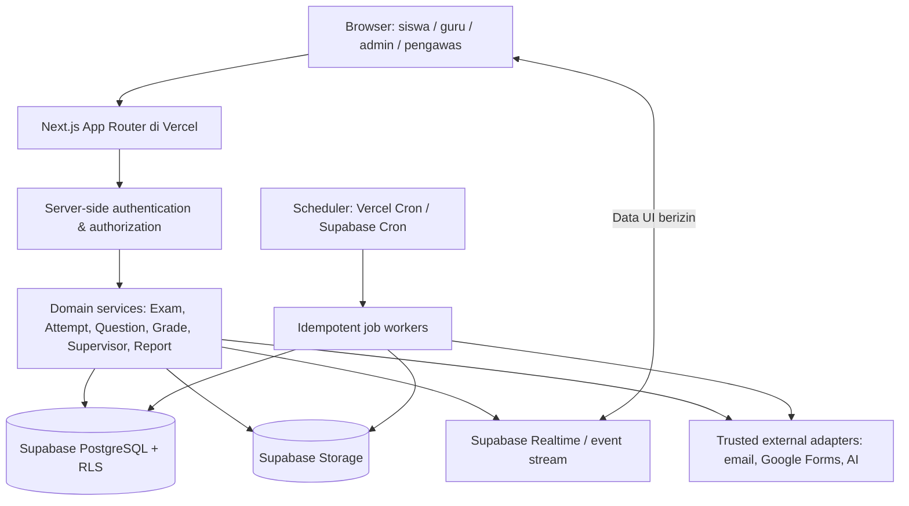

# DOKUMEN DASAR PEMBANGUNAN ULANG EDUTARA CBT

**Cetak biru teknis, inventaris fitur, kontrak perilaku, migrasi data, keamanan, dan kriteria penerimaan**  
Versi dokumen: **1.0** | Audit sumber: **26 Oktober 2026** | Status: **rancangan implementasi; belum ada aplikasi baru yang dibangun atau diuji**

> **Prinsip mutlak:** pembangunan ulang adalah *functional-equivalence rebuild*, bukan sekadar menyalin tampilan. Semua kemampuan dan alur bisnis EDUTARA CBT yang teridentifikasi harus tersedia. Perilaku yang rentan, tidak konsisten, atau berisiko tidak boleh disalin sebagai kerentanan; lakukan *behavioral compatibility* pada hasil yang sah dengan perbaikan keamanan, integritas data, dan aksesibilitas.

## 0. Identitas, sumber, dan batas validasi

| Aspek | Hasil verifikasi |
|---|---|
| Repositori | `https://github.com/amtsnurulfalah-commits/edutaracbt` |
| Cabang diperiksa | `main` |
| Commit diperiksa | `1a4407c727f2660e40019177c5920bab45afb815` |
| Berkas repositori | `Code.gs` dan `index.html` (dua berkas; tidak ada `README.md` pada commit ini) |
| `Code.gs` | 513.051 byte menurut metadata GitHub; ±12.443 baris; 222 deklarasi `function` terdeteksi (termasuk fungsi dalam fungsi) |
| `index.html` | 2.242.276 byte menurut metadata GitHub; **50.835 baris kode** (termasuk baris terakhir kosong); 1.057 deklarasi `function` terdeteksi (termasuk fungsi dalam fungsi), 33 tag `<script>` |
| Blob SHA `Code.gs` | `9f7ebec17a4a7103a51417db3e00c62f647eda91` |
| Blob SHA `index.html` | `71bcdc15134ad5baf35bc17d99d93f7bee169fd5` |
| Frontend asli | HTML besar, CSS, Tailwind CDN, JavaScript vanilla, DOM dinamis, `google.script.run`; SweetAlert2, TinyMCE, MathJax, XLSX-js-style, Font Awesome |
| Backend asli | Google Apps Script (GAS), Google Sheets, Google Drive/Slides, trigger Apps Script, MailApp, `UrlFetchApp` |
| Stack tujuan | **Next.js App Router + TypeScript + Vercel + Tailwind CSS + shadcn/ui + Zod + Supabase PostgreSQL/Auth/Storage** |

**Berkas sumber:** [Code.gs](https://github.com/amtsnurulfalah-commits/edutaracbt/blob/main/Code.gs), [index.html](https://raw.githubusercontent.com/amtsnurulfalah-commits/edutaracbt/refs/heads/main/index.html). Penggunaan commit tetap di atas penting agar implementasi tidak diam-diam membandingkan versi sumber yang telah berubah.

**Metode audit:** struktur repositori diverifikasi; isi lengkap kedua blob sumber berhasil dibaca melalui GitHub, lalu dipetakan fungsi, tanggung jawab, aturan data, alur UI, dan relasi antar-modul. Pemeriksaan ini adalah **audit statis**. Tidak tersedia akses ke spreadsheet produksi, berkas Drive sebenarnya, endpoint GAS yang berjalan, data rahasia, histori aktivitas pengguna, atau lingkungan browser produksi. Karena itu **belum dapat diklaim** semua perilaku telah dibuktikan melalui pengujian E2E; semua fitur di bawah perlu diuji terhadap data/skenario nyata. Jangan menandai fitur sebagai selesai hanya berdasarkan dokumen ini.

**Keamanan sumber:** kode lama memuat pengenal spreadsheet eksternal, seed akun contoh, dan mekanisme password plaintext. Dokumen sengaja tidak mencantumkan nilai pengenal atau kredensial tersebut. Saat memigrasikan, hindari menyalin secret ke source baru, batasi akses data lama, serta lakukan rotasi password/kunci yang telah terekspos bila masih digunakan.

## 1. Tujuan produk dan ruang lingkup

Aplikasi baru berfungsi sebagai sistem **Computer Based Test (CBT)** terpadu untuk pengelolaan jadwal ujian, bank soal multimodal, peserta dan guru, penyelenggaraan ujian aman, pengawas ujian dan pengawas pengganti, ruang ujian, pengawasan langsung, koreksi, rekap, analisis butir, ekspor dokumen, pemberitahuan, dan administrasi. Bahasa utama antarmuka: **Indonesia**, dengan dukungan teks Arab, rumus matematika/LaTeX, beragam resolusi perangkat, keyboard seluler, serta zona waktu sekolah.

**Cakupan organisasi:** satu instansi/sekolah sesuai perilaku repositori sekarang. Belum ada bukti isolasi multi-tenant pada kode asli. Bila produk baru harus multi-madrasah, rancang `organization_id` dan seluruh RLS sejak awal sebagai **pengembangan terencana**, jangan mengaku fitur multi-tenant sudah ada pada sumber. Rekomendasi teknis: tambahkan `organization_id` ke skema sekarang untuk kesiapan masa depan, tanpa membuat admin antarinstansi saling melihat data.

**Autentikasi:** sumber saat ini menggunakan basis pengguna sendiri di spreadsheet utama dan lembar kredensial tambahan bagi staf; **tidak ada bukti integrasi Central SSO sebagai login utama**. Karena permintaan hanya menetapkan stack, rancangan default menggunakan autentikasi internal yang aman pada aplikasi baru (Supabase Auth diutamakan), sambil menyediakan lapisan adaptor identitas terpisah apabila integrasi SSO diputuskan di tahap berikutnya. Jangan mengintegrasikan Central SSO diam-diam.

## 2. Inventaris seluruh kelompok fitur yang wajib dipertahankan

Penanda prioritas: **P0** = wajib sebelum sistem ujian digunakan; **P1** = wajib untuk cakupan fitur penuh; **P2** = wajib sebelum dinyatakan setara sepenuhnya jika modul terkait digunakan. Status semua item awal: `BELUM DIIMPLEMENTASIKAN`.

| ID | Kelompok kemampuan (perilaku sumber) | Prioritas | Area baru |
|---|---|---|---|
| F01 | Halaman login responsif, pilihan peran Siswa / Admin-Guru / Pengawas, validasi form, PIN ujian siswa, remember username, status jaringan, sesi tersimpan, pemulihan login, logout | P0 | `/login`, Auth |
| F02 | Peran Admin, Guru, Pengawas, Siswa; status aktif; Guru memiliki pasangan mata pelajaran–kelas; Guru dapat menjadi pengawas saat mendapat penugasan | P0 | RBAC + assignments |
| F03 | Dashboard admin/guru dengan statistik, informasi terkini, command palette dan lonceng aktivitas; UI sidebar collapse/mobile | P1 | `/dashboard` |
| F04 | CRUD jadwal ujian: mapel, beberapa kelas, waktu mulai/akhir, durasi, PIN, status, passing grade, pengacakan, konfigurasi jenis & kuota soal, bypass periode input, duplikasi dan hapus massal | P0 | `/dashboard/exams` |
| F05 | Otomatisasi status ujian dari jadwal, aktif/nonaktif, penutupan, timeout otomatis | P0 | exam scheduler |
| F06 | Bank soal lima tipe: PG, PG kompleks, BS, JODOH, Esai, poin, wajib/tidak, kunci, pembahasan/rubrik, lampiran gambar/audio, min karakter esai | P0 | `/dashboard/questions` |
| F07 | Pembatasan tipe soal per ujian (`enabled`, `max`, `optCount`, `defaultPoint`), validasi dan kuota saat menambah, edit, menyalin, dan impor | P0 | question service |
| F08 | Editor rich text (TinyMCE), rumus MathJax/LaTeX, keyboard karakter/simbol/Arab/matematika, pratinjau, sisip gambar/audio | P1 | rich question editor |
| F09 | Input soal satuan, bulk text multi-format dengan parser/validator serta pratinjau blok valid-gagal, copy template, impor Excel, impor Google Forms, salin antarujian, hapus massal | P1 | import/export adapters |
| F10 | Periode global input soal Guru, pengecualian per ujian, guard server, indikator progress/target pembuatan soal per guru dan per ujian | P1 | authoring policy |
| F11 | Siswa login menggunakan PIN yang cocok dengan kelas dan ujian; validasi waktu/status; dapat masuk hasil saja bila telah menyelesaikan ujian | P0 | student flow |
| F12 | Pemilihan soal berdasarkan tipe, urutan tipe, acak soal tiap tipe dan acak pilihan PG/PG kompleks, navigasi prev/next dan nomor soal, jawaban tiap tipe | P0 | exam player |
| F13 | Timer ujian, resume, autosave/jeda sinkronisasi, status `In Progress`/`Completed`/`Waktu Habis`/`Curang`, submit manual/otomatis | P0 | attempts + deadlines |
| F14 | Kontrol anti-kecurangan: full screen, deteksi kehilangan fokus/pindah tab, Windows/Meta, pagehide, copy/cut/paste/menu konteks; catat insiden, blur, intervensi pengawas | P1 | integrity events |
| F15 | Dukungan ujian ponsel landscape, toleransi perubahan orientasi & keyboard virtual, wake lock, modal konfirmasi/peringatan dan toleransi waktu | P1 | exam UX |
| F16 | Esai rich text, batas karakter opsional, pratinjau MathJax, mode menggambar di canvas, konversi gambar/rumus menjadi LaTeX via layanan eksternal | P1 | essay answer editor |
| F17 | Penilaian objektif (termasuk kredit parsial tipe tertentu), nilai akhir 0–100, passing grade dan label kelulusan | P0 | grading engine |
| F18 | Koreksi esai per peserta/per soal, batch save, progress koreksi, skor esai manual, rekalkulasi nilai | P0 | grading + ledger |
| F19 | Bantuan penilaian esai AI, skor saran beserta alasan, satu soal/batch, terima/ubah lalu simpan oleh pengajar | P1 | AI grading adapter |
| F20 | Rekap hasil ujian, filter, sortir, pencarian, pagination, status, buka blokir, reset percobaan, detail jawaban, cetak/unduh per siswa | P0 | `/dashboard/results` |
| F21 | Analisis butir PG/PG kompleks/BS/JODOH, tingkat kesukaran, daya pembeda, sebaran pilihan, data peserta salah, analisis esai | P1 | `/dashboard/analytics` |
| F22 | Laporan per peserta, ringkasan per kelas, ekspor Excel, PDF dan cetak massal | P1 | reports |
| F23 | CRUD pengguna semua peran, aktif/nonaktif, penugasan guru, impor massal siswa/pengguna, unduh template, filter, pagination | P0 | `/dashboard/users` |
| F24 | Data master kelas/mapel; tambah/ubah/hapus/search/sort/bulk paste | P1 | `/dashboard/master-data` |
| F25 | Manajemen gambar dan audio: upload batch, drag/drop, sinkron dari folder, galeri/tabel, salin URL, proteksi akses, pemilihan lampiran dan hapus | P1 | media + Storage |
| F26 | Kartu ujian siswa perorangan/massal, template, ekspor PDF dan ZIP, progress pembuatan | P1 | exam cards |
| F27 | Pemantauan ujian real-time/polling, statistik siswa, jumlah jawaban, waktu, status login/ujian/curang, detail pelanggaran, filter, export, unlock/reset, operasi bulk | P0 | `/dashboard/monitor` |
| F28 | Kirim notifikasi dari petugas ke semua peserta/ujian/peserta terpilih, terima notifikasi di layar ujian, status terbaca dan riwayat | P1 | notifications |
| F29 | Manajemen pengawas per ujian-ruang-sesi, penunjukan pengawas pengganti, pencabutan, otorisasi pengawas efektif dan audit | P0 | supervisors |
| F30 | Dashboard/monitor khusus Pengawas sesuai penugasan; akses terbatas peserta di ruangnya; aksi unlock/reset/notifikasi sesuai izin | P0 | `/supervisor` |
| F31 | CRUD ruang ujian, kapasitas, penugasan pengawas, tambah/hapus peserta, penolakan siswa ganda antar-ruang pada ujian sama, sinkron nama ruang/penugasan | P0 | rooms + rosters |
| F32 | Konfigurasi identitas dan tampilan aplikasi, logo, gambar login, hasil siswa, batas pelanggaran, fitur canvas, pengaturan kop PDF, folder media, kartu, kunci AI | P1 | `/dashboard/settings` |
| F33 | Audit log tindakan admin/pengawas/guru: login/logout, perubahan data, blokir/unlock, nilai, backup, penugasan | P1 | audit logs |
| F34 | Backup manual/terjadwal akhir semester, pemeriksaan trigger, backup data dan lampiran | P1 | backup/recovery |
| F35 | Pengingat email progres input soal Guru (periode mendekati akhir), verifikasi status email dari sumber lama dan mekanisme anti-duplikasi pengiriman | P2 | notifications/jobs |
| F36 | Format dokumen institusi: kop, identitas pejabat, daftar soal PDF, rekap hasil PDF, laporan per siswa, kartu peserta | P1 | rendering service |

**Aturan penerimaan cakupan:** setiap F01–F36 harus punya halaman/fitur yang dapat diakses, pemeriksaan izin server, CRUD/alur yang diuji, dan padanan perilaku sumber. Modul yang bersifat opsional secara operasional (misalnya AI) boleh hanya aktif bila konfigurasi resmi tersedia, tetapi UI, penanganan error, dan pengujiannya tetap wajib.

## 3. Peta navigasi berdasarkan halaman sumber

### 3.1 Halaman pengguna

- **Login**: mode Siswa, Admin/Guru, atau Pengawas; username/password; siswa wajib PIN numerik; modal/panel mobile dan notifikasi kesalahan/sukses.
- **Ujian Siswa**: header mata pelajaran/siswa/timer, pertanyaan lima tipe, navigasi nomor, indikator jawaban, modal gambar/zoom, media audio, bantuan rumus, kontrol ujian, keamanan browser, notifikasi masuk.
- **Hasil Siswa**: nilai dan status lulus bila `show_exam_result=true`; jika false hanya pesan telah selesai, tanpa membocorkan kunci jawaban/nilai tersembunyi.
- **Admin/Guru**: Dashboard, Jadwal Ujian, Bank Soal, Progress Pembuatan Soal, Hasil & Nilai, Manajemen Siswa/Pengguna, Gambar, Audio, Koreksi Esai, Analisis Butir, Log Aktivitas; Admin juga mempunyai Kartu Siswa, Data Master, Pengawas, Ruang Ujian, Konfigurasi.
- **Pengawas**: Dashboard pengawasan, monitor peserta sesuai penugasan, pengendalian ujian sesuai cakupan dan notifikasi ke siswa.

### 3.2 Usulan route Next.js App Router

```text
src/app/
  (public)/login/page.tsx
  (student)/exam/[attemptId]/page.tsx
  (student)/exam/[attemptId]/review/page.tsx
  (student)/results/[attemptId]/page.tsx
  (panel)/dashboard/page.tsx
  (panel)/dashboard/exams/page.tsx
  (panel)/dashboard/questions/page.tsx
  (panel)/dashboard/question-progress/page.tsx
  (panel)/dashboard/results/page.tsx
  (panel)/dashboard/monitor/page.tsx
  (panel)/dashboard/essay-grading/page.tsx
  (panel)/dashboard/item-analysis/page.tsx
  (panel)/dashboard/users/page.tsx
  (panel)/dashboard/master-data/page.tsx
  (panel)/dashboard/media/images/page.tsx
  (panel)/dashboard/media/audio/page.tsx
  (panel)/dashboard/exam-cards/page.tsx
  (panel)/dashboard/supervisors/page.tsx
  (panel)/dashboard/rooms/page.tsx
  (panel)/dashboard/settings/page.tsx
  (panel)/dashboard/audit-logs/page.tsx
  (supervisor)/supervisor/page.tsx
  (supervisor)/supervisor/monitor/page.tsx
  api/auth/**
  api/exams/**
  api/attempts/**
  api/questions/**
  api/media/**
  api/import/**
  api/export/**
  api/ai/**
  api/cron/**
```

Gunakan *layout* per peran, sidebar dan navbar reusable, highlight route aktif, skeleton per halaman, dialog shadcn/ui dengan fokus keyboard, tabel responsif, dan muat data halaman secara independen. Navigasi membuka halaman target **dahulu**, lalu mengambil data halaman tersebut; jangan memuat semua data sistem pada setiap perpindahan route. Berikan state loading/empty/error/retry; cegah horizontal overflow pada layar kecil.

## 4. Peran, otorisasi, dan batas data

| Aksi | Admin | Guru | Pengawas | Siswa |
|---|:---:|:---:|:---:|:---:|
| Kelola jadwal ujian | Ya | Lihat yang ditugaskan | Hanya jadwal ruang bertugas | Tidak |
| Kelola bank soal | Ya | Ya, hanya mapel–kelas sendiri dan selama periode | Tidak | Tidak |
| Periksa hasil / koreksi | Ya | Ya, ujian sendiri | Monitoring sesuai penugasan, bukan nilai global | Hasil sendiri jika diizinkan |
| Kelola pengguna | Semua | Siswa dalam kelas yang ditugaskan, sesuai kebijakan | Tidak | Tidak |
| Monitoring semua ujian | Ya | Hanya kelas/ujian penugasan | Hanya ruang/ujian efektif | Tidak |
| Buka blokir / reset peserta | Ya | Ujian/kelas sendiri | Peserta ruang/ujian efektif | Tidak |
| Kirim notifikasi peserta | Ya | Ujian/kelas sendiri | Ujian/ruang efektif | Tidak |
| Pengawas, ruang, master, konfigurasi | Ya | Tidak | Tidak | Tidak |
| Mengerjakan ujian | Tidak melalui dashboard staf | Tidak melalui dashboard staf | Tidak melalui dashboard pengawas | Hanya attempt dirinya yang valid |

**Hak Guru di kode lama:** pasangan `mapel:kelas` disimpan sebagai string dalam kolom `Users.Class` untuk Guru; parsing campuran string dan JSON juga ditemukan. Matching sebagian memakai `.includes()` sehingga berisiko menghasilkan kecocokan terlalu luas. Di PostgreSQL wajib menjadi relasi terstruktur `teacher_assignments(user_id, subject_id, class_id)`, dengan *exact matching* ID dan cakupan akses diperiksa pada setiap query/mutasi.

**Pengawas efektif:** jika baris tugas memiliki pengganti aktif, **pengganti** yang berhak atas ruang/ujian tersebut; pengawas asli sementara kehilangan hak penugasan itu. Ketika pengganti dicabut, hak kembali ke pengawas asli. Role `Guru` yang memperoleh penugasan dapat masuk *mode Pengawas* tanpa mengganti role asal. Simpan `original_role` dan `active_context`, jangan timpa role akun permanen.

**RLS dan server policy:** jangan mengandalkan menu tersembunyi. Semua perubahan dan semua query server wajib membaca identitas dari sesi yang diverifikasi, memeriksa role aktif dan objek target, serta membatasi data sesuai instansi/ujian/kelas/ruang. Kunci jawaban tidak boleh dikirim lewat API siswa sebelum kebijakan rilis memungkinkan.

## 5. Model domain dan state machine

### 5.1 Status ujian

- Status sumber: `Aktif`, `Non-Aktif`, `Completed`/`Selesai` (terdapat beberapa ejaan dalam source). Pendaftaran peserta mengecek PIN, kelas, status, dan waktu mulai/akhir.
- Pisahkan dalam model baru: `draft | scheduled | active | closed | archived`, dengan adapter label lama. Jangan hanya mengandalkan kolom status yang ditulis browser atau cron; **evaluasi jendela waktu berdasarkan jam server**.
- `end_at > start_at`; durasi menit positif; ujian aktif saat jadwal mengizinkan; selesai tidak membuka attempt baru; peserta yang sudah selesai hanya dapat melihat hasil menurut setting.
- `PassingGrade` sumber adalah ambang **skor 0–100**, bukan jumlah poin mentah; jika tidak dikonfigurasi (`0`) label lulus/null tidak dipaksa.

### 5.2 Status attempt siswa

```text
NOT_STARTED --(PIN/kelas/jadwal valid)--> IN_PROGRESS
IN_PROGRESS --(autosave)--> IN_PROGRESS
IN_PROGRESS --(submit manual)--> SUBMITTED
IN_PROGRESS --(durasi atau end_at lewat)--> TIME_EXPIRED
IN_PROGRESS --(pelanggaran terkonfirmasi sesuai kebijakan)--> DISQUALIFIED
DISQUALIFIED --(unlock sah oleh petugas)--> IN_PROGRESS [dengan audit dan aturan waktu]
IN_PROGRESS/SUBMITTED/... --(reset berwenang)--> NOT_STARTED [riwayat tetap diarsipkan]
SUBMITTED/TIME_EXPIRED --(grade esai)--> GRADED
```

**Adapter lama:** `In Progress` → `in_progress`; `Completed`/`Selesai` → `submitted/graded` (berdasarkan grade); `Waktu Habis` → `time_expired`; `Curang` → `disqualified`. Status tersebut tidak boleh saling tertukar dalam laporan/monitor. Simpan kapan, siapa, dan alasan semua *override*.

### 5.3 Aturan login, sesi, dan resume

1. Pengguna aktif, password valid, context role legal.
2. Siswa wajib memasukkan PIN ujian numerik yang cocok dengan ujian dan salah satu kelasnya; cek jendela waktu dan status.
3. Ambil atau buat attempt `user_id + exam_id`, default **maksimal satu attempt aktif per ujian**. Desain baru dapat mengizinkan attempt ulang hanya melalui versi/reset berizin.
4. Untuk attempt `disqualified`, blokir sampai tindakan pemulihan resmi.
5. Jika sudah selesai, tampilkan hasil saja bila `show_exam_result=true`; selain itu tampilkan pesan selesai tanpa skor.
6. Jika resume: kembalikan jawaban sebelumnya dan **sisa waktu dari server**, bukan restart timer di browser. Kode lama menggunakan `__pausedElapsedSec__` sebagai metadata internal snapshot ketika curang/unlock; simpan sebagai kolom normal di attempt yang terpisah dari jawaban.
7. Jika waktu habis saat offline/browser tertutup, finalisasi melalui server/cron saat berikutnya; tidak boleh memperoleh tambahan waktu akibat reload.
8. Jika peserta masuk di perangkat lain, gunakan kebijakan sesi yang eksplisit (misalnya single active session + revocation), tampilkan pesan jelas.

### 5.4 Bentuk soal dan nilai

- **PG:** satu jawaban, benar mendapat bobot penuh, salah/kosong = 0.
- **PG Kompleks:** beberapa jawaban benar; sumber memberi parsial `bobot × (jumlah opsi benar dipilih / total opsi benar)` **hanya jika tidak ada opsi salah yang dipilih**. Jika ada opsi salah, nilai soal = 0. Pastikan respons siswa berupa himpunan tanpa duplikasi.
- **BS:** tiap pernyataan benar memberi `bobot / jumlah pernyataan`; menerima padanan `Benar/Salah` dan di kode lama juga `Sesuai/Tidak Sesuai`. Kunci bisa memakai teks pernyataan atau indeks legacy. Adapter migrasi wajib mengakomodasi keduanya.
- **JODOH:** nilai `bobot × (jumlah pasangan benar / total pasangan)`; pasangan legacy berbentuk `{q,a}` dan jawaban siswa berupa mapping `q -> a`; padanan legacy `MATCHING` juga muncul di fungsi koreksi.
- **Esai:** nilai awal **0** sebelum dinilai guru; skor per soal `0..bobot`, dapat desimal; skor AI hanyalah rekomendasi. Setelah skor manual disimpan, **nilai akhir dihitung ulang** dari semua soal objektif dan skor esai.
- **Skor akhir:** `round(100 × total_poin_diperoleh / total_bobot, 2)` dengan total bobot seluruh soal ujian. Simpan hasil serta versi kunci/penilaian yang digunakan.
- **Batas bobot impor teks:** backend parser batch memvalidasi bobot `0.01..100`, konten `1..2000` karakter, panjang opsi `1..500`, jumlah opsi PG/PG kompleks antara 2 dan `optCount` (pengaturan sumber normalnya 2–6, default 5). Kebijakan yang sama perlu diterapkan secara konsisten ke input satuan, edit, impor dan salin; bila terjadi perbedaan legacy, dokumentasikan di tes kesetaraan.
- **IsRequired:** setiap soal punya flag wajib/tidak wajib. Sebelum submit manual, validator klien/server memberi konfirmasi untuk soal wajib yang kosong; **timeout/curang tetap harus dapat difinalisasi**.
- **Esai:** rubrik penilaian, batas minimum karakter opsional, format rich text/LaTeX dan gambar/canvas merupakan metadata terpisah.

### 5.5 Randomisasi yang tidak merusak kunci

Urutan sumber: soal diklasifikasikan dan ditampilkan dalam lima kelompok (`PG → PG_KOMPLEKS → BS → JODOH → Esai`); `shuffleConfig` dapat mengacak urutan dalam tiap kelompok, sementara opsi PG/PG kompleks diacak. Implementasi baru **wajib menyimpan snapshot urutan soal, urutan opsi, ID opsi, serta versi soal pada attempt** sehingga resume dan audit tidak berubah walaupun guru mengedit soal. Gunakan ID opsi sebagai jawaban kanonik; migrasi kunci huruf/teks harus diselesaikan **sebelum** mengacak. Jangan mengevaluasi menggunakan urutan opsi yang sudah diacak atau label A/B yang dapat berubah.

### 5.6 Pembuatan soal batch dan periode input

Alur batch: `parse teks` → `validasi per blok di browser` → `pratinjau valid/invalid` → `verifikasi sesi & akses ujian` → `cek periode` → `kunci transaksi` → `validasi ulang di server` → `cek tipe aktif` → `cek kuota/opsi` → `cek duplikat` → `simpan` → `hasil count/skipped/details`. Sumber membatasi satu request batch **maksimal 500 soal**. Kode balasan memiliki kategori `AUTH`, `PERIOD`, `CONFIG_MISSING`, `TYPE_DISABLED`, `QUOTA`, `SYSTEM` beserta detail item yang dilewati. Implementasi baru wajib mendukung respons per item, *idempotency key*, rollback aman, log dan kuota transaksional, bukan hanya pesan sukses umum.

`TypeConfig` per ujian: setiap tipe mempunyai `enabled`, `max`, `defaultPoint`; PG/PG_KOMPLEKS juga `optCount`. `max=0` harus dipastikan semantik kompatibelnya sebelum implementasi (kode sumber memakai `max=0` sebagai nilai default dan mempunyai pemeriksaan kuota; uji kasus 0 serta batas tepat). Target progres Guru = penjumlahan `max` seluruh tipe yang aktif; bandingkan terhadap jumlah soal yang tersimpan per ujian. Guru dibatasi periode input global `[start,end]` inklusif jika aktif; Admin selalu bebas periode dan ujian dapat `bypassInputPeriod`.


## 6. Model data target PostgreSQL / Supabase

### 6.1 Prinsip skema

1. Gunakan `uuid` sebagai kunci internal dan simpan `legacy_id` berindeks unik untuk rekonsiliasi. Jangan menggunakan `Date.now()` atau random 4 digit sebagai identitas primer.
2. Simpan **satu sumber kebenaran** untuk identitas, kunci jawaban, jawaban peserta, penilaian, dan hak akses; hindari data paralel yang dapat berubah terpisah tanpa transaksi.
3. Simpan tanggal/waktu sebagai `timestamptz` (UTC) dan zona waktu lembaga sebagai konfigurasi IANA, tampilkan dalam waktu sekolah. Jangan menyimpan string tanggal yang ambigu.
4. Siapkan `organization_id` pada seluruh data bisnis yang bersifat milik sekolah; versi awal satu organisasi tetap dapat memakai struktur ini.
5. Semua *foreign key*, *unique constraints*, `check constraints`, indeks dan tindakan `ON DELETE` harus dirancang eksplisit. Data ujian/nilai/audit memakai **soft delete/arsip**, bukan kaskade penghancuran bukti.
6. Gunakan `jsonb` untuk metadata yang bervariasi (konfigurasi tiap jenis soal, representasi jawaban legacy, payload analisis), bukan menggantikan relasi utama. Versikan format JSON melalui `schema_version`.
7. Rekaman yang mengalami perubahan pada saat ujian berlangsung memerlukan *immutable snapshot*: pertanyaan, opsi, kunci, poin, rubrik, urutan tampil, durasi, dan kebijakan grading yang berlaku bagi attempt itu.

### 6.2 Pemetaan database legacy → entitas baru

| Sumber legacy | Kolom utama yang dibaca | Tabel/entitas baru | Catatan transformasi |
|---|---|---|---|
| `Users` | `UserID`, `Nama`, `Password`, `Role`, `Class`, `SessionToken`, `IsActive` | `auth.users`, `profiles`, `user_roles`, `student_enrollments`, `teacher_assignments` | Siswa: `Class` menunjuk kelas; Guru: string/JSON assignment; jangan impor token/password plaintext ke tabel aplikasi |
| Spreadsheet kredensial `Users` eksternal | `Updated`, `Username`, `Password` | Supabase Auth + `profiles.legacy_username` | Lakukan aktivasi/reset akun staf secara aman; bukan menyimpan password terbaca |
| `Exams` | `ExamID`, `Subject`, `Class`, `Date`, `Duration`, `PIN`, `Status`, `EndDate`, `ShuffleConfig`, `TypeConfig`, `PassingGrade`, `BypassInputPeriod` | `exams`, `exam_classes`, `exam_type_configs` | Pecah daftar kelas; PIN berupa hash server; type config dinormalisasi/JSON terstruktur |
| `Questions` | `QuestionID`, `ExamID`, `Type`, `Content`, `ImageURL`, `Options`, `CorrectAnswer`, `IsRequired`, `Point`, `Rubric`, `MinChar`, `MinCharEnabled`, `AudioURL` | `questions`, `question_options`, `question_statements`, `question_pairs`, `question_versions`, `media_assets` | Tipe legacy persis dan semua representasi kunci tetap punya adapter; konten HTML disanitasi |
| `Responses` | `ResponseID`, `UserID`, `ExamID`, `AnswersJSON`, `Score`, `StartTime`, `SubmitTime`, `Status` | `exam_attempts`, `attempt_answers`, `answer_revisions`, `grade_items`, `grading_runs` | Metadata khusus `_essay_scores_per_question`, `_manual_essay_score`, `_ai_scores`, `_ai_reasons`, `__pausedElapsedSec__` diekstrak menjadi kolom terpisah |
| `Logs` | `LogID`, `UserID`, `ExamID`, `ViolationCount`, `Details`, `Timestamp` | `exam_integrity_events` | Simpan event mentah beserta kategori, waktu server, perangkat, tindakan, decision; jumlah diolah terpisah |
| `AdminLogs` | `LogID`, `Timestamp`, `ActorID`, `ActorName`, `Action`, `TargetType`, `TargetID`, `Details` | `audit_logs` | *append-only*, metadata tersaring, sebelum/sesudah bila aman dan relevan |
| `Gambar`, `Audio` | ID, nama, tautan, folder, pengunggah, proteksi password | `media_assets`, Supabase Storage | Migrasi file bytes; catat origin/legacy URL; privat, signed URL; jangan pertahankan password media plaintext |
| `Konfigurasi` | `Key`, `Value` | `app_settings`, `document_templates`, *secret manager* | Pisahkan pengaturan publik, konfigurasi sensitif, dan pengaturan internal cron |
| `Master_Data` | `List_Kelas`, `List_Mapel` | `classes`, `subjects` | Unik dalam organisasi dan nama ternormalisasi; jangan hilangkan label aslinya |
| `Notifications` | ID pengirim, tipe sasaran, IDs, exam, pesan, waktu, `ReadBy` | `notifications`, `notification_targets`, `notification_reads` | Jangan terus menulis satu JSON `ReadBy` yang rawan race-condition |
| `Supervisors` | ID tugas, exam, room name, session label, ID/nama pengawas asli, ID/nama pengganti | `supervisor_assignments`, `supervisor_substitutions` | Pengawas efektif dihitung dari pengganti aktif; gunakan FK ruang stabil |
| `ExamRooms` | `RoomID`, `ExamID`, `RoomName`, `SupervisorAssignID`, `StudentIDs`, `Capacity` | `exam_rooms`, `exam_room_students` | Satu siswa maksimal satu ruang per ujian; kapasitas `0` tanpa batas |
| GAS trigger/cache | setup/reminder/backup/timeout flags dan progress key | `scheduled_jobs`, `job_runs`, `email_deliveries`, `export_jobs`, `backup_jobs` | Terjadwal, *retry* aman, deduplikasi dan observabilitas |

### 6.3 Daftar tabel yang disarankan

**Identitas dan akademik**

- `organizations(id, name, timezone, settings, created_at)`; pada fase pertama isi satu organisasi.
- `profiles(id [FK auth.users], organization_id, legacy_user_id, username_normalized, full_name, active, created_at, updated_at)`; normalisasi username *case-insensitive*.
- `user_roles(user_id, organization_id, role)` dengan enum operasional `admin|teacher|supervisor|student`; role kontekstual Pengawas untuk Guru disimpan di sesi konteks terpisah, bukan mengubah `user_roles`.
- `classes(id, organization_id, name, active)`; `subjects(id, organization_id, name, active)`.
- `student_enrollments(student_id, class_id, organization_id, active_since, active_until)`.
- `teacher_assignments(teacher_id, class_id, subject_id, organization_id, active)`; indeks komposit, unik untuk assignment aktif.
- `identity_migration_map(legacy_user_id, auth_user_id, migration_status, activation_status)` dalam skema privat.

**Ujian dan soal**

- `exams(id, organization_id, legacy_exam_id, subject_id, title, starts_at, ends_at, duration_minutes, pin_hash, status_override, passing_grade, show_results_override, shuffle_config jsonb, bypass_input_period boolean, created_by, version, archived_at)`.
- `exam_classes(exam_id, class_id, organization_id)`; satu ujian boleh memiliki lebih dari satu kelas.
- `exam_type_configs(exam_id, type, enabled, max_questions, option_count, default_points)` untuk `PG`, `PG_KOMPLEKS`, `BS`, `JODOH`, `Esai`.
- `questions(id, organization_id, exam_id, legacy_question_id, type, content_html, required, points, rubric, min_chars, enforce_min_chars, image_asset_id, audio_asset_id, position, current_version, created_by, deleted_at)`.
- `question_versions(question_id, version, payload jsonb, created_by, created_at)` immutable; `payload` mempertahankan opsi/kunci/rubrik/attachment pada versi itu.
- `question_options(id, question_id, order_index, content_html, is_correct)` untuk PG dan PG kompleks; alternatif: simpan seluruh snapshot pada `question_versions` sebagai model kanonik. Pilih satu desain agar konsisten.
- `question_statements(id, question_id, order_index, content_html, correct_value)` untuk BS.
- `question_pairs(id, question_id, order_index, left_html, right_html)` untuk JODOH; jawaban klien menunjuk ID pasangan.
- `question_import_batches(id, exam_id, actor_id, source_type, idempotency_key, parsed_count, inserted_count, skipped_count, errors jsonb, status)`.

**Pengerjaan dan penilaian**

- `exam_attempts(id, organization_id, exam_id, student_id, legacy_response_id, attempt_number, status, started_at, deadline_at, submitted_at, resumed_at, paused_elapsed_seconds, device_session_id, shuffle_snapshot jsonb, exam_policy_snapshot jsonb, score_percent, passing_status, graded_at, version, updated_at)`.
- `attempt_answers(id, attempt_id, question_id, question_version, value jsonb, revision, saved_at)`; unik `(attempt_id, question_id)`.
- `answer_revisions(id, attempt_answer_id, revision, value jsonb, saved_at, request_id)` untuk *replay*, audit, dan penanganan sinkronisasi.
- `grade_items(id, attempt_id, question_id, question_version, source [auto|manual|ai_suggestion], awarded_points, max_points, rubric_snapshot, evaluator_id, reason, approved_at)`; skor AI saran **tidak** otomatis masuk nilai resmi.
- `grading_runs(id, attempt_id, version, computed_by, computed_at, objective_points, essay_points, maximum_points, score_percent, policy_version, notes)`; simpan histori hitung ulang.
- `exam_integrity_events(id, attempt_id, type, client_occurred_at, server_received_at, severity, client_context jsonb, countable, resolved_by, resolution)`.
- `attempt_overrides(id, attempt_id, action [unlock|reset|extend|finish], actor_id, reason, previous_state jsonb, next_state jsonb, created_at)`.

**Pengawas, ruang, komunikasi**

- `exam_rooms(id, organization_id, exam_id, legacy_room_id, name, capacity, created_at, updated_at)`; unik nama ternormalisasi pada satu ujian.
- `exam_room_students(id, room_id, exam_id, student_id, enrolled_at)`; unik `(exam_id, student_id)`.
- `supervisor_assignments(id, organization_id, exam_id, room_id, legacy_assignment_id, session_label, original_supervisor_id, active, created_at)`.
- `supervisor_substitutions(id, assignment_id, substitute_supervisor_id, effective_from, effective_until, appointed_by, revoked_by, reason)`; tentukan satu pengganti aktif per assignment.
- `notifications(id, organization_id, sender_id, exam_id, message, target_type, sent_at, expires_at)`.
- `notification_targets(notification_id, student_id)` dan `notification_reads(notification_id, user_id, read_at)`; unik pasangan.
- `teacher_input_periods(id, organization_id, enabled, starts_at, ends_at, updated_by)`; jika kebutuhan sumber global satu periode, hanya satu baris aktif per organisasi.
- `email_delivery_log(id, organization_id, teacher_id, template_code, period_id, notification_date, notification_hour, status, provider_message_id, sent_at)`; indeks unik untuk deduplikasi.

**Operasional, media, dokumen**

- `media_assets(id, organization_id, kind [image|audio|drawing], bucket, object_path, original_name, mime_type, byte_size, uploader_id, visibility, checksum, legacy_url, deleted_at)`.
- `document_templates(id, organization_id, type [exam_card|header|recap|question_sheet|student_report], config jsonb, version, active)`.
- `export_jobs(id, organization_id, requested_by, kind, scope jsonb, status, output_asset_id, progress, error, created_at, completed_at)`.
- `backup_jobs(id, organization_id, trigger [manual|semester], status, completed_at, storage_location, checksum, retention_until, restore_tested_at)`.
- `audit_logs(id, organization_id, actor_id, action, target_type, target_id, context jsonb, request_id, created_at)`.
- `app_settings(organization_id, key, value jsonb, is_secret boolean, updated_at)`; **nilai rahasia hanya di server/secret manager**, bukan di baris yang bisa dibaca lewat Data API.
- `scheduled_jobs`, `job_runs` dan `outbox_events` untuk pemrosesan asinkron yang andal.

### 6.4 Kendala integritas wajib di database

- `exam_attempts`: `(exam_id, student_id, attempt_number)` unik; satu *active attempt* per `(exam_id, student_id)` memakai partial unique index atas status aktif, atau aturan retry serializable dalam transaksi.
- `exam_room_students`: `(exam_id, student_id)` unik; *exam_id* harus sama dengan yang dimiliki `room_id` (enforce dengan FK komposit atau trigger teruji).
- Penugasan Guru: `(teacher_id, subject_id, class_id)` unik untuk penugasan aktif.
- Pertanyaan: `points > 0`, `question type` salah satu dari lima nilai; validasi jumlah opsi/kunci dan bobot dipusatkan di service domain.
- Ujian: `ends_at > starts_at`, `duration_minutes > 0`, `passing_grade BETWEEN 0 AND 100`, kapasitas ruang nonnegatif.
- Nilai esai: `0 <= awarded_points <= max_points` dalam transaksi; hanya skor yang disetujui Guru/Admin masuk agregat resmi.
- Auto-submit dan sinkronisasi harus idempoten: jangan membiarkan request berulang membuat dua attempt/dua finalisasi atau mengubah jawaban setelah final.
- Semua tabel yang memuat data siswa memiliki FK organisasi/ujian/kelas sesuai cakupan. Jangan membuat policy RLS yang bergantung pada field `role` atau `organization_id` dari body klien.

### 6.5 Contoh SQL pondasi (ilustrasi, **bukan migrasi final siap produksi**)

```sql
-- Urutan berikut adalah sketsa struktur inti, bukan pengganti migrasi lengkap.
create extension if not exists pgcrypto;

create table public.organizations (
  id uuid primary key default gen_random_uuid(),
  name text not null,
  timezone text not null default 'Asia/Jakarta'
);

create table public.profiles (
  id uuid primary key references auth.users(id) on delete restrict,
  organization_id uuid not null references public.organizations(id),
  legacy_user_id text,
  username_normalized text not null,
  full_name text not null,
  active boolean not null default true,
  created_at timestamptz not null default now(),
  unique (organization_id, username_normalized),
  unique (organization_id, legacy_user_id)
);

create table public.exams (
  id uuid primary key default gen_random_uuid(),
  organization_id uuid not null references public.organizations(id),
  legacy_exam_id text,
  subject_id uuid, -- tambahkan FK setelah public.subjects dibuat
  title text not null,
  starts_at timestamptz not null,
  ends_at timestamptz not null,
  duration_minutes integer not null check (duration_minutes > 0),
  pin_hash text not null,
  passing_grade numeric(5,2) not null default 0
    check (passing_grade between 0 and 100),
  shuffle_config jsonb not null default '{}'::jsonb,
  bypass_input_period boolean not null default false,
  check (ends_at > starts_at),
  unique (organization_id, legacy_exam_id),
  unique (id, organization_id)
);

create table public.exam_attempts (
  id uuid primary key default gen_random_uuid(),
  organization_id uuid not null,
  exam_id uuid not null,
  student_id uuid not null references public.profiles(id),
  attempt_number integer not null default 1 check (attempt_number > 0),
  status text not null default 'in_progress' check
    (status in ('in_progress', 'submitted', 'time_expired',
                'disqualified', 'graded', 'reset')),
  started_at timestamptz not null default now(),
  deadline_at timestamptz not null,
  submitted_at timestamptz,
  score_percent numeric(5,2),
  version bigint not null default 0,
  foreign key (exam_id, organization_id)
    references public.exams(id, organization_id),
  unique (exam_id, student_id, attempt_number)
);

create unique index exam_attempt_one_in_progress
  on public.exam_attempts(exam_id, student_id)
  where status = 'in_progress';

-- RLS wajib pada SEMUA tabel public yang terekspos, termasuk contoh ini.
alter table public.organizations enable row level security;
alter table public.profiles enable row level security;
alter table public.exams enable row level security;
alter table public.exam_attempts enable row level security;

-- Contoh aman untuk data profil pribadi. Policy lain harus dibuat menurut matriks role.
create policy "pengguna lihat profil sendiri"
  on public.profiles for select to authenticated
  using ((select auth.uid()) = id);
```

**Perhatian:** DDL contoh belum mencakup semua FK, policy baca admin/guru, indeks produksi, hingga transaksi reset; lanjutkan sebagai *versioned migrations* dan tes integrasi. Bila seluruh akses sensitif hanya lewat server dengan kredensial priviledged, tetap batasi service layer dan hindari `service_role` untuk permintaan biasa; key admin/secret tidak boleh dikirim ke browser. Policy `TO authenticated` tanpa filter objek juga **tidak memadai**.

## 7. Spesifikasi modul dan perilaku layar

### 7.1 Autentikasi dan akun (F01–F02, F23)

- Tiga konteks login mengikuti sumber: **Siswa**, **Admin/Guru**, dan **Pengawas**. Satu Guru dapat memilih konteks Admin/Guru untuk tugas mengajar atau Pengawas jika penugasannya efektif; akun Pengawas khusus hanya masuk konteks Pengawas.
- Bila sistem memakai username non-email seperti `ADM-001`/`SIS-001`, bangun mapping username internal ke identitas Auth yang valid di server. Jangan membuat *pseudo-email* terbuka yang bisa ditebak untuk pengambilalihan password. Tentukan mekanisme aktivasi dan pemulihan kredensial.
- Verifikasi password menggunakan Supabase Auth atau mekanisme yang didukung secara aman; batasi percobaan login, audit login/logout, CAPTCHA bila diperlukan. Jangan pernah mengembalikan password pengguna dalam respons API maupun file ekspor rutin.
- Sesi dengan cookie `HttpOnly`, `Secure`, `SameSite` sesuai alur, rotasi dan invalidasi aktif; `remember me` menyimpan **username saja**, bukan token rahasia di localStorage. Login tab Siswa wajib validasi PIN + kelas di server.
- Modal login/validasi ringkas, status offline/online, *focus management*, penanganan Caps Lock, toggle tampil password, loading hanya selama request relevan, modal tidak keluar layar ponsel.
- CRUD pengguna: tambah/edit/nonaktif/hapus logis, kelas siswa, penugasan mapel–kelas Guru, pengawas; pencarian, filter, sort, pagination, seleksi massal, impor Excel, file template, rekonsiliasi kesalahan per baris; Guru hanya mengelola kelasnya sesuai izin.
- Saat menonaktifkan akun, cabut sesi untuk operasi sensitif; tampilkan log siapa melakukan, sebelum/sesudah, alasan.

### 7.2 Dashboard dan navigasi (F03)

- Ringkasan jumlah ujian, soal, peserta, hasil, progres pengerjaan/penilaian, aktivitas baru, dan waktu aplikasi. Server mengirim agregasi yang sudah dibatasi role.
- Sidebar *collapsible* desktop serta *drawer* mobile; navigasi berbasis route tanpa `innerHTML` yang menghapus semua state; tooltips saat collapse; posisi aktif persisten dan label sesuai role.
- Command palette `Ctrl/Cmd+K`, lonceng aktivitas, pencarian quick-actions, skeleton serta data empty/error/retry; *close popover on navigation*, tanpa kebocoran handler atau polling dari layar lain.
- Navbar/footer responsif; menu yang dilarang tidak dirender, **namun** API masih menolak akses langsung.

### 7.3 Jadwal, kuota dan periode soal (F04–F05, F07, F10)

- Form modal tambah/edit/duplikasi ujian: mapel, judul, satu atau banyak kelas, mulai, selesai, durasi, PIN, passing grade, `shuffleConfig`, lima `TypeConfig`, dan `bypassInputPeriod`.
- Perubahan jadwal tidak merusak attempt yang sudah mulai. Jika perlu memodifikasi duration/rubrik/soal saat aktif, gunakan prosedur versioning dan kebijakan perubahan terotorisasi.
- Filter/sort/status/pagination, salin PIN oleh admin, toggle status dengan *audit*, pemilihan massal dan delete aman. Bedakan `tutup manual` dari `belum jadwal` agar cron tak membuka ulang ujian yang ditutup sengaja.
- Periode input Guru global, *bypass* ujian tertentu, tampilan hitung mundur waktu input dan progres mencapai target jumlah soal per ujian. Guru ditolak server saat periode habis; Admin tidak diblokir.
- Penambahan/edit/copy/import memperhitungkan jumlah tiap tipe, `enabled`, `max`, default poin dan jumlah opsi. Cegah race dua guru menghabiskan kuota bersamaan dengan transaksi database.

### 7.4 Bank soal dan editor (F06, F08–F09)

- Tab lima tipe: **PG** satu kunci, **PG_KOMPLEKS** multi-kunci, **BS** array pernyataan benar/salah, **JODOH** pasangan, **Esai** dengan rubrik dan aturan minimum karakter.
- WYSIWYG rich text dengan whitelist HTML, gambar/audio yang disimpan sebagai attachment terpisah, MathJax atau KaTeX (uji kesetaraan sintaks), dukungan huruf Arab RTL/LTR, karakter khusus, rumus, notasi dan keyboard bantu.
- Aksi add/edit/view preview/copy/delete satu atau bulk, paginasi serta filter jenis, tag status, dan perhitungan jumlah soal; gunakan komponen dengan state terkontrol, tidak mengandalkan event global.
- **Impor teks batch:** parser format legacy menoleransi whitespace, tag tipe soal, informasi atribut, kunci, poin, jumlah opsi, opsi terpilih, tipe BS/JODOH/Esai. Ada template siap salin dan contoh per jenis; pratinjau memisahkan item valid/gagal beserta alasan & nomor blok. Proses simpan hanya yang valid sesuai kontrak; report `inserted`, `skipped`, `reason`, `blockNumber`.
- **Impor Excel:** unduh template dengan kolom per tipe, validasi header/cell dan file tidak valid; tampilkan hasil preview sebelum commit. **Impor Google Forms:** implementasikan *connector/adaptor berizin* (mungkin perlu OAuth Google), jelaskan dengan ramah jika integrasi belum tersambung; jangan gunakan API publik tanpa autentikasi. Kunci jawaban hasil impor harus direkonsiliasi, tidak boleh menebak secara diam-diam.
- **Salin soal antarujian:** salin konten/opsi/kunci/rubrik/attachment referensi, buat ID baru, tetap cek hak mata pelajaran/kelas, kuota tujuan, dan *immutable attempt snapshots*.

### 7.5 CBT siswa dan keamanan ujian (F11–F16)

- Halaman ujian dibuka setelah *server gate* dengan ujian dan kelas valid, PIN, waktu server serta status attempt. Urutan navigasi dan shuffle sama bagi satu attempt saat reload.
- Tersedia tombol `Sebelumnya`/`Berikutnya`, peta nomor, indikasi dijawab/belum/wajib, tampilan respons sesuai tipe, gambar zoom dan audio player, soal teks/math/Arab, modal konfirmasi kumpul.
- Jawaban tersimpan dengan autosave/debounce, indikator `menyimpan/tersimpan/gagal`, retry berbatas, idempotency key dan `answer revision`. Penyimpanan dari dua tab/perangkat tidak boleh menimpa revisi lebih baru.
- Timer berasal dari `deadline_at` server, dengan sinkron ulang dan penanganan jam perangkat tidak tepat. Durasi tidak bertambah karena offline. `submit` tidak menandai sukses sebelum transaksi server mengonfirmasi.
- Tangani reload, browser crash, sinyal hilang, lock/unlock petugas, timeout, selesai, reset serta tampilan hasil saja dengan pesan yang sesuai. Jangan kehilangan jawaban esai yang panjang.
- Anti-cheat tetap menyajikan **full screen/landscape/wake lock bila didukung browser**, deteksi `visibilitychange`, kehilangan fokus, keluar fullscreen, shortcut terlarang, salin/tempel, pelanggaran dan dialog peringatan; toleransi keyboard virtual/orientasi dan batas insiden bisa dikonfigurasi.
- **Catatan jaminan:** JavaScript di browser tidak dapat mencegah tangkapan layar, perangkat kedua, DevTools, atau kecurangan yang terjadi di luar aplikasi dengan kepastian. Catat sinyal secara proporsional, jelaskan konsekuensinya, dan batasi *false positive* akibat gangguan aksesibilitas/jaringan.
- Mode esai: editor tulisan dengan validasi jumlah karakter yang benar setelah menghapus tag HTML, rumus dan simbol, canvas gambar/undo/clear/warna/ukuran pena serta kemampuan konversi canvas ke LaTeX oleh layanan backend berizin. Gambar yang besar dipindahkan ke Storage, **bukan** dipotong string Base64-nya sampai korup.

### 7.6 Nilai, esai AI, progres (F17–F19)

- Satu *grading engine* TypeScript yang murni/dapat diuji dipakai oleh submit, hitung ulang nilai, laporan, analisis butir, dan koreksi esai. Pastikan tidak ada implementasi rumus berbeda antar-modul.
- Nilai PG/PG kompleks/BS/JODOH dihitung server berdasarkan snapshot kunci dan opsi; Esai menunggu penilaian manual; nilai total versi terbaru ditandai dan proses grading idempoten.
- Koreksi esai melalui daftar per ujian, peserta, soal, rubric, respon penuh termasuk gambar dan formula, pemberian skor desimal yang tidak melebihi bobot; *batch save* dalam transaksi, validasi role/assignment per attempt target.
- Ringkasan progres: jumlah peserta, soal esai, jawaban yang sudah dinilai, belum dinilai; klik menuju modal detail/kolom penilaian. Nilai `0` yang sengaja diberikan guru harus diakui **sudah dinilai**, berbeda dari nilai `null` belum diperiksa.
- AI: pemilihan satu jawaban, semua jawaban satu soal atau batch pending; simpan `suggested_score`, `reason`, model/provider/prompt version/cost/timestamp; guru boleh menerima, mengubah, menolak. **Skor AI tidak dianggap nilai sah sampai dikonfirmasi**. Jika panggilan AI gagal/JSON rusak, tampilkan status gagal, jangan diam-diam menetapkan `0` sebagai hasil valid.
- Provider/gateway layanan AI disetel menggunakan secret server, dengan timeout, rate limit, validasi JSON oleh Zod, pengaburan data pribadi peserta dari prompt, perizinan, dan pengawasan biaya.

### 7.7 Monitoring, pengawas dan ruang (F27–F31)

- **Admin monitor:** tabel/kartu ringkasan siswa belum login, sedang ujian, selesai, waktu habis, curang, respons/total soal, jumlah insiden, sisa waktu dan ruang; filter ujian/kelas/status/ruang, pencarian, statistik live, tombol refresh dan ekspor Excel.
- **Live:** Supabase Realtime/DB-trigger/event subscriptions bila sesuai, dengan fallback polling dan interval terkendali; berhentikan subscription saat meninggalkan halaman, batasi stream sesuai permission.
- **Pengawas:** dashboard dan monitor hanya untuk assignment efektif; dari sumber, Guru yang login konteks Pengawas dapat mengakses hanya tugas yang didelegasikan. Pengawas asli otomatis tidak memiliki akses pada assignment yang sedang diambil alih oleh pengganti.
- **Aksi pengawasan:** buka blokir, reset satu/banyak siswa, lihat log pelanggaran, kirim pesan untuk peserta dalam scope. Semua aksi meminta konfirmasi dan alasan jika mengubah integritas ujian; dicatat audit.
- **Manajemen pengawas:** tambah/edit/hapus tugas per ujian, ruang dan sesi, validasi Pengawas/Guru aktif, larang pengganti sama dengan pengawas asli, tunjuk/cabut pengganti; identitas pengawas efektif dihitung di server.
- **Ruang:** tambah/edit/hapus ruang unik per ujian, atur kapasitas `0 = unlimited`, pilih assignment pengawas, tambah/hapus peserta tunggal/massal, cari/filter peserta eligible berdasarkan kelas ujian dan aktif. Wajib tolak satu siswa masuk dua ruang berbeda pada ujian sama, bahkan jika dua Admin menyimpan secara bersamaan. Sinkronisasi ruang–pengawas gunakan ID relasi, bukan pencocokan nama teks yang berubah.

### 7.8 Hasil, analitik dan laporan (F20–F22, F36)

- Hasil ujian: pencarian/filter kelas/mapel/status/nilai, urut, pagination, kartu mobile, detail jawaban, skor, status, kelulusan, waktu mulai/akhir, reset/unlock sesuai izin, XLSX/PDF, laporan siswa.
- **Analisis PG:** proporsi benar `P = benar / seluruh peserta selesai`; kelompok atas dan bawah masing-masing `max(1, floor(0.27 × N))` setelah diurut menurut nilai; `D = benar_atas/n - benar_bawah/n`. Batas kesukaran legacy: `P < 0.30` sukar; `0.30..0.70` sedang; `P > 0.70` mudah. Daya pembeda: `D < 0` negatif/buang, `<0.20` jelek, `<0.30` cukup, `<0.40` baik, sisanya sangat baik.
- **Analisis PG kompleks:** pilihan benar multipel dengan evaluasi kunci sesuai aturan grading dan laporan butir (opsi/tanggapan), jangan disamakan buta dengan PG tunggal.
- **Analisis BS:** tiap pernyataan memiliki benar/salah, jumlah jawaban benar/salah, siswa yang keliru, dan statistik butir sesuai implementasi sumber.
- **Analisis JODOH:** evaluasi pasangan individual/soal, tab rincian peserta salah serta skor; jangan hilangkan analisis tipe ini saat porting.
- **Analisis esai:** kemajuan koreksi, skor dan rekomendasi AI jika ada; pelaporan jawaban dan rubrik, kemampuan unduh.
- **Cetak/PDF:** kop sekolah/instansi, logo, pejabat/tanda tangan bila dikonfigurasi, lembar soal, rekap nilai, lembar jawaban, laporan rinci peserta, rekap per kelas dan *bulk print*. Berikan tautan hasil unduhan yang aman dan kadaluarsa, indikator proses dan penanganan PDF besar.

### 7.9 Media, kartu, konfigurasi, audit, backup dan pengingat (F24–F26, F32–F35)

- **Master data:** kelola kelas/mapel, add/edit/delete/bulk paste; data yang sudah direferensikan oleh soal/ujian tidak dihapus permanen tanpa kebijakan.
- **Media:** gambar/audio file upload batch, drop-zone, penamaan dan tipe MIME, daftar/pencarian/tabel/galeri, preview/play, menyalin URL semantik, tautan privat, attachment picker, hapus. Adapter migrasi folder Drive ke Storage; jika Drive tetap dipakai, autentikasi dan masa berlaku URL harus eksplisit.
- **Kartu peserta:** pilihan siswa, template pengaturan, PDF tunggal/massal, file ZIP, progress job dan indikator selesai/gagal; kartu mempertahankan nama, username, kelas dan informasi jadwal/PIN bila dibutuhkan. **Jangan cetak password permanen** seperti implementasi template lama; gunakan kode aktivasi sekali pakai atau kredensial sementara yang kedaluwarsa sesuai kebijakan.
- **Pengaturan:** identitas nama/subjudul/logo/background, batas pelanggaran, show result, esai canvas, jam auto-timeout, kunci/provider AI dan test koneksi, pengaturan media/card/template/kop PDF serta input period. Pisahkan form umum dan secret; tampilkan nilai secret sebagai `tersimpan/tidak tersimpan`, tidak pernah mengembalikan raw secret dari API.
- **Audit:** daftar aktivitas yang dapat difilter berdasar actor/waktu/kategori/objek, detail, export CSV; login/logout staf, CRUD ujian/soal/pengguna, koreksi/reset/unlock, pengawas/pengganti/ruang, backup.
- **Backup:** manual dan otomatis semester, status jadwal, lokasi aman dan pemeriksaan *restore drill*; backup harus mencakup PostgreSQL, objek Storage, konfigurasi dan metadata template. Retensi dan penghapusan diatur, setiap backup tercatat di audit.
- **Email pengingat:** evaluasi kemajuan per Guru terhadap target berdasarkan lima tipe soal; saat `input_period` akan habis ≤24 jam, pada jam lokal `11,13,15,17,19,21,23` (meniru kode asal) dan hanya jika email terverifikasi/valid serta ada kekurangan target. Idempotensi `(period, teacher, local_date, local_hour, template)`; status pengiriman/gagal/retry tersimpan. Integrasi email provider resmi dan template Indonesia.


## 8. Arsitektur implementasi target

### 8.1 Arsitektur logis



**Batas tanggung jawab**

- **Next.js:** RSC untuk dashboard awal, Client Components untuk interaksi ujian dan form; Route Handlers/Server Actions untuk mutasi; middleware/proxy sesi sesuai versi Next.js yang dipilih dan diuji; validasi dan audit tetap berada di service layer.
- **TypeScript:** domain model, discriminated union tipe soal, typed DTO, penanganan hasil operasi dan error codes konsisten. `any` dilarang pada engine grading/policy/auth.
- **Tailwind + shadcn/ui:** satu design system, dialog, form, table, sheet, badge status, sidebar, input, dropdown, command palette; aksesibilitas, dark-mode opsional bila tidak mengganggu keterbacaan.
- **Zod:** schema request/response (terutama batch import, answer payload, grade, PIN, setting dan AI); **validasi ulang pada server** setiap mutasi. Library input form boleh menggunakan React Hook Form + resolvers.
- **Supabase Auth:** identitas, sesi cookie SSR melalui `@supabase/ssr` dan `@supabase/supabase-js`; username akun lama dipetakan ke profil. `getClaims()`/`getUser()` memverifikasi identitas dalam konteks sesuai, `getSession()` tidak digunakan sendirian sebagai bukti otorisasi.
- **Supabase PostgreSQL:** transaksi, constraints, RLS, agregasi/report, immutable grading ledger; skema bisnis dipisahkan dari kunci Auth dan tabel rahasia.
- **Supabase Storage:** gambar/audio/canvas/PDF/ZIP/backup terpisah bucket sesuai klasifikasi; URL terotorisasi dan signed link berbatas waktu. Raw `service_role` hanya server dan job berizin.
- **Realtime dan job:** feed monitor, event notifikasi, progress ekspor, timeout, scheduler dan email; seluruh event harus dipastikan scope role/organisasi.
- **Adapter eksternal:** Google Forms/Drive bila masih dibutuhkan, server-side AI, email, PDF. Kegagalan adapter tidak boleh menghilangkan jawaban ujian.

**Pertimbangan skalabilitas:** pada Vercel serverless, request tidak memiliki memori bersama persisten. Semua lock, state live, progress job, kuota, idempotency key, dan sesi disimpan pada PostgreSQL/layanan yang dirancang untuk itu, bukan variabel global proses. PDF/ZIP besar diproses lewat job yang memadai, bukan dipaksakan ke request pendek.

### 8.2 Struktur direktori proyek yang direkomendasikan

```text
edutara-cbt/
├── src/
│   ├── app/
│   │   ├── (auth)/login/page.tsx
│   │   ├── (student)/exam/[attemptId]/page.tsx
│   │   ├── (student)/results/[attemptId]/page.tsx
│   │   ├── (dashboard)/dashboard/.../page.tsx
│   │   ├── (supervisor)/supervisor/.../page.tsx
│   │   ├── api/
│   │   │   ├── auth/{login,logout,session}/route.ts
│   │   │   ├── exams/[examId]/.../route.ts
│   │   │   ├── attempts/[attemptId]/.../route.ts
│   │   │   ├── questions/.../route.ts
│   │   │   ├── users/.../route.ts
│   │   │   ├── rooms/.../route.ts
│   │   │   ├── supervisors/.../route.ts
│   │   │   ├── imports/.../route.ts
│   │   │   ├── exports/.../route.ts
│   │   │   ├── grading/.../route.ts
│   │   │   ├── notifications/.../route.ts
│   │   │   ├── settings/.../route.ts
│   │   │   ├── analytics/.../route.ts
│   │   │   └── cron/{activate,timeout,remind,backup}/route.ts
│   │   ├── layout.tsx
│   │   ├── loading.tsx
│   │   ├── error.tsx
│   │   └── not-found.tsx
│   ├── components/
│   │   ├── ui/                     # shadcn/ui primitives
│   │   ├── shell/                  # Sidebar, Navbar, Footer, CommandMenu
│   │   ├── exams/                  # ExamForm, TypeConfig, ScheduleTable
│   │   ├── questions/              # QuestionEditor, BatchImport, Preview
│   │   ├── student-exam/           # ExamPlayer, NavGrid, Timer, SecurityGate
│   │   ├── grading/                # EssayGrader, Rubric, AIReview
│   │   ├── analytics/              # PG, PGK, BS, Jodoh, Essay charts
│   │   ├── monitor/                # LiveStatus, Filters, ViolationPanel
│   │   ├── supervisors/            # Assignment, Substitute, RoomPanel
│   │   ├── media/                  # Image/AudioPickers, uploader
│   │   └── reports/                # Preview, PrintTemplates
│   ├── features/
│   │   ├── auth/                    # policy, forms, session context
│   │   ├── exams/                   # commands + queries
│   │   ├── questions/               # parser + validation + services
│   │   ├── attempts/                # state machine, autosave, timer
│   │   ├── grading/                 # PURE score functions
│   │   ├── item-analysis/           # PURE analysis functions
│   │   ├── users/
│   │   ├── monitoring/
│   │   ├── supervisors/
│   │   ├── rooms/
│   │   ├── notifications/
│   │   ├── reports/
│   │   ├── settings/
│   │   └── jobs/
│   ├── lib/
│   │   ├── supabase/{client,server,admin}.ts
│   │   ├── auth/{require-actor,permissions}.ts
│   │   ├── database/{queries,transactions}.ts
│   │   ├── validation/*.ts
│   │   ├── integrations/{anthropic,google,email}.ts
│   │   ├── storage/*.ts
│   │   ├── errors.ts
│   │   └── time.ts
│   ├── types/{database,domain,api}.ts
│   └── styles/globals.css
├── supabase/
│   ├── migrations/
│   ├── seed.sql
│   └── tests/
├── scripts/
│   ├── legacy-export/
│   ├── legacy-transform/
│   ├── legacy-import/
│   └── parity-check/
├── tests/
│   ├── unit/
│   ├── integration/
│   ├── security/
│   ├── e2e/
│   └── fixtures/legacy/
├── docs/
│   ├── api-contracts.md
│   ├── feature-parity.md
│   ├── data-mapping.md
│   ├── threat-model.md
│   ├── operations-runbook.md
│   └── decisions/
├── .env.example
├── next.config.ts
├── eslint.config.*
├── tsconfig.json
├── package.json
└── package-lock.json             # atau lockfile lain, dikomit konsisten
```

Tanda `...` pada tree adalah placeholder struktur; bukan nama berkas sungguhan. Pisahkan *presentation* dari business logic, dan gunakan *dependency injection* untuk grading/clock/storage agar test tidak harus menjalankan browser.

### 8.3 Komponen dan library pendamping yang wajar

- `@supabase/supabase-js`, `@supabase/ssr`; versi dipin dan lockfile dikomit.
- `zod`, `react-hook-form`, resolver Zod, `@tanstack/react-query` (cache UI yang cakupannya jelas), `@tanstack/react-table` bila tabel rumit.
- `shadcn/ui`, Radix primitives, Lucide icons, Tailwind; jangan mewarisi CDN Tailwind untuk produksi.
- Editor rich text: TinyMCE paket yang kompatibel React atau TipTap, diputuskan setelah tes HTML/LaTeX/Arabic legacy. Sanitizer HTML di server dan UI (misalnya DOMPurify sesuai environment).
- Ekspor: library XLSX yang mendukung gaya/data type yang diperlukan; server-side PDF builder/HTML renderer yang tersedia dan cocok dengan batas deployment. ZIP streaming/background job untuk kartu massal.
- Date/time: API waktu IANA (*mis.* Luxon atau date-fns-tz) dengan parsing dan format eksplisit.
- Testing: Vitest/Jest, React Testing Library, Playwright, pgTAP/DB integration, axe aksesibilitas, load/performance tests.

**Jangan menyalin** `google.script.run`, `SpreadsheetApp`, `DriveApp`, `SlidesApp`, `MailApp`, `ScriptApp`, atau HTML monolitik ke Next.js. Porting dilakukan pada **kontrak perilaku + service**, bukan dengan membuat emulasi GAS di browser.

### 8.4 Pengaturan lingkungan (contoh key, tanpa nilai rahasia)

```dotenv
# Aman untuk browser: project URL dan publishable key, tetap dengan RLS
NEXT_PUBLIC_SUPABASE_URL=
NEXT_PUBLIC_SUPABASE_PUBLISHABLE_KEY=

# Server only: bila layanan backoffice membutuhkan akses terprivileg
SUPABASE_SECRET_KEY=

# Server only: akses provider eksternal, cron, dokumen
AI_PROVIDER=
AI_API_KEY=
AI_BASE_URL=
EMAIL_PROVIDER_API_KEY=
CRON_SECRET=

# Metadata konfigurasi organisasi, fallback aplikasi
APP_DEFAULT_TIMEZONE=Asia/Jakarta
APP_BASE_URL=
```

Catatan: sesuaikan nama key dengan SDK/project aktual; variabel `NEXT_PUBLIC_*` **pasti terlihat oleh browser**. Jangan memakai `NEXT_PUBLIC_` untuk `service_role`, private key, token cron, atau API AI. Deploy Preview/Production menggunakan secret terpisah, akses minimal, rotasi dan pemindaian kebocoran.

## 9. Kontrak API dan kompatibilitas dengan fungsi GAS

### 9.1 Konvensi umum

Semua request dengan body disaring menggunakan Zod, semua respons memiliki bentuk konsisten:

```ts
type ApiSuccess<T> = {
  success: true;
  data: T;
  requestId: string;
};
type ApiFailure = {
  success: false;
  error: {
    code: 'AUTH' | 'FORBIDDEN' | 'NOT_FOUND' | 'VALIDATION' |
          'PERIOD' | 'CONFIG_MISSING' | 'TYPE_DISABLED' |
          'QUOTA' | 'CONFLICT' | 'EXAM_CLOSED' |
          'TIME_EXPIRED' | 'RATE_LIMIT' | 'SYSTEM';
    message: string;
    details?: unknown;
  };
  requestId: string;
};
```

Gunakan HTTP status sesuai kategori: `400/422` validasi, `401` belum login, `403` akses ditolak, `404` objek di luar scope atau tidak ditemukan, `409` versi/idempotency/kuota, `429` rate limit, `5xx` error server. **Jangan pernah mempercayai userID, role, score, answerKey, atau token sumber dari body sebagai identitas berwenang.** Gunakan subject sesi yang diverifikasi di server.

### 9.2 Endpoint utama dan pemetaan legacy

| Route + metode baru | Operasi | GAS lama yang sepadan |
|---|---|---|
| `POST /api/auth/login` | Login username/password, konteks dan optional PIN Siswa; set sesi aman | `loginUser`, `validateExamPIN` |
| `GET /api/auth/session` | Validasi dan data aktor/konteks terkini | `checkSession`, `isValidSession` |
| `POST /api/auth/logout` | Logout dan revoke sesi | `logoutUser` |
| `GET /api/exams` | Daftar ujian sesuai scope, status, konfigurasi | `getExamList` |
| `POST /api/exams` | Buat ujian | `createExam` |
| `PATCH /api/exams/:id` | Edit ujian | `updateExam`, `toggleExamStatus` |
| `DELETE /api/exams/:id` | Arsip/hapus aman | `deleteExam`, `deleteExamsBulk` |
| `GET /api/exams/:id/questions` | Soal untuk staf, termasuk kunci jika berizin | `getQuestionsByExam` |
| `POST /api/exams/:id/questions` | Tambah soal | `addQuestion` |
| `PATCH /api/questions/:id` | Perbarui soal berversi | `updateQuestion` |
| `DELETE /api/questions/:id` | Soft delete atau bulk delete | `deleteQuestion`, `deleteQuestionsBulk` |
| `POST /api/exams/:id/questions/batch` | Validasi/commit bulk soal, maksimal 500 | `saveBatchQuestions`, `backendValidateBatch_`, `enforceTypeConfig_` |
| `POST /api/imports/questions/excel` | Impor Excel + preview | `saveImportedQuestions`, parsing frontend |
| `POST /api/imports/questions/forms` | Impor dari Google Forms | `importQuestionsFromForm` |
| `POST /api/exams/:id/questions/copy` | Copy bank soal | `copyQuestions` |
| `GET /api/question-progress` | Progres target guru | `getQuestionProgressData`, `evaluateAllTeachersProgress_` |
| `POST /api/attempts/start` | Verifikasi PIN/kelas/jadwal; buat/resume attempt | `validateExamPIN`, `getExamQuestions` |
| `GET /api/attempts/:id` | Soal tanpa kunci, snapshot, jawaban dan sisa waktu | `getExamQuestions` |
| `PATCH /api/attempts/:id/answers` | Autosave batch + revision | `syncAnswers` |
| `POST /api/attempts/:id/submit` | Finalisasi aman dan hitung skor | `submitExam` |
| `POST /api/attempts/:id/integrity-events` | Catat kejadian keamanan ujian | `logViolation` |
| `POST /api/attempts/:id/unlock` | Buka blokir sesuai izin | `unlockStudentExam`, `bulkUnlockStudents` |
| `POST /api/attempts/:id/reset` | Reset attempt dengan alasan | `resetStudentExam`, `bulkResetStudents` |
| `GET /api/results` | Rekap hasil role-scoped | `getExamResults` |
| `GET /api/results/:attemptId` | Detail jawaban peserta yang berizin | `getStudentAnswerDetail(s)` |
| `GET /api/students/me/results/:id` | Hasil milik siswa jika show-results aktif | `getMyExamResult` |
| `GET /api/essay-grading` | Progres dan detail koreksi | `getEssayGradingProgress`, `getEssayGradingDetail`, `getEssayData` |
| `POST /api/grading/essay` | Koreksi esai manual/batch | `saveEssayGrade`, `batchSaveEssayGrades` |
| `POST /api/grading/essay/suggest` | Saran skor AI, bukan final | `scoreEssayWithAI`, `saveAIScoreToResponse` |
| `POST /api/grading/recalculate` | Hitung ulang nilai berotorisasi | `recalculateExamScores` |
| `GET /api/analytics/items` | Analisis PG, PGK, BS, JODOH, esai | `getItemAnalysis`, `getBSItemAnalysis`, `getJODOHItemAnalysis`, `getEssayAnalysisData` |
| `GET /api/reports/student/:id` | Laporan peserta | `getStudentDetailReport`, `generateStudentDetailPDF` |
| `GET /api/reports/class/:id` | Ringkasan kelas | `getClassSummaryReport`, `generateExamRecapPDF` |
| `POST /api/exports` | PDF/Excel/ZIP sebagai job | `generateLembarSoalPDF`, `generateExamHTML`, `downloadKartuMassal` |
| `GET /api/exports/:jobId` | Progress dan URL unduhan aman | `checkDownloadProgress` |
| `GET /api/users` | Daftar pengguna berizin, TANPA password | `getUserList` |
| `POST/PATCH/DELETE /api/users` | CRUD, aktif/nonaktif, impor massal | `createUser`, `updateUser`, `deleteUser`, `toggleUserStatus`, `importUsersBulk` |
| `GET/POST/PATCH /api/master-data` | Kelas/mapel | `getMasterData`, `saveMasterData` |
| `GET/POST/DELETE /api/media` | Gambar/audio/rekaman canvas | `getSavedImages`, `getSavedAudio`, `uploadImageFile`, `uploadAudioFile`, `processFolderImages`, `processFolderAudio`, `deleteSavedImage`, `deleteSavedAudio` |
| `POST /api/media/:id/access` | Akses media dan signed URL | `verifyImageAccess`, `verifyAudioAccess` |
| `GET /api/monitor` | Dashboard live/polling | `getExamMonitorData` |
| `GET /api/supervisor/dashboard` | Statistik pengawas | `getDashboardDataForSupervisor` |
| `GET /api/supervisor/monitor` | Monitor hanya penugasan efektif | `getMonitorDataForSupervisor` |
| `GET/POST/PATCH/DELETE /api/supervisors/assignments` | CRUD penugasan | `getSupervisorAssignments`, `createSupervisorAssignment`, `updateSupervisorAssignment`, `deleteSupervisorAssignment` |
| `PUT/DELETE /api/supervisors/assignments/:id/substitute` | Tetapkan/cabut pengganti | `setSubstituteSupervisor`, `clearSubstituteSupervisor` |
| `GET/POST/PATCH/DELETE /api/rooms` | CRUD, sinkron roster dan pengawas | `getExamRooms`, `createExamRoom`, `updateExamRoom`, `deleteExamRoom` |
| `POST/DELETE /api/rooms/:id/students` | Enroll/remove peserta | `addStudentsToRoom`, `removeStudentFromRoom`, `getExamRoomStudentData` |
| `POST/GET /api/notifications` | Kirim/riwayat pesan ke siswa | `sendStudentNotification`, `getStudentNotifications`, `getSentNotifications` |
| `POST /api/notifications/:id/read` | Mark read per pengguna | `ReadBy` legacy |
| `GET/PATCH /api/settings` | Konfigurasi termasuk jadwal input soal | `getAppConfig`, `saveAppConfig`, `getInputPeriod`, `saveInputPeriod` |
| `GET /api/audit-logs` | Jejak perubahan | `getAdminLogs` |
| `POST /api/backups` | Backup manual Admin | `manualBackup`, `backupDataToDrive` |
| `POST /api/cron/*` | Aktivasi otomatis, timeout, pengingat, backup | `autoActivateExams`, `autoTimeoutInProgressExams`, `sendInputReminderNotifications`, `setupSemesterBackupTrigger` |

**Peta di atas adalah kontrak layanan yang disarankan**, bukan route yang sudah ada di repositori. Satu fungsi GAS boleh dipecah ke beberapa service baru dan beberapa fungsi GAS boleh disatukan pada satu API dengan *authorization check* yang sama. Jangan mengimplementasikan endpoint yang mengizinkan client meminta soal ujian beserta kuncinya.

### 9.3 Contoh kontrak mulai/resume ujian

```http
POST /api/attempts/start
Content-Type: application/json

{"examPin":"12345"}

HTTP/1.1 200 OK
{
  "success": true,
  "data": {
    "attemptId": "uuid-attempt",
    "examId": "uuid-exam",
    "status": "in_progress",
    "deadlineAt": "2026-10-27T02:00:00Z",
    "serverNow": "2026-10-27T01:20:00Z",
    "remainingSeconds": 2400,
    "questionSetVersion": 7,
    "isResumed": false
  },
  "requestId": "req-id"
}
```

Contoh hanya ilustrasi bentuk, bukan PIN atau data sistem sebenarnya. Sesi mengidentifikasi siswa secara server-side, bukan field `userId` dari browser. PIN dicocokkan secara *timing-safe* terhadap hash/identitas ujian yang berada dalam cakupan kelas dan jadwal valid. Jika lebih dari satu ujian memakai PIN serupa, server tidak boleh memilih ujian arbitrer; tetapkan aturan disambiguasi.

### 9.4 Contoh kontrak autosave aman

```http
PATCH /api/attempts/{attemptId}/answers
Content-Type: application/json

{
  "clientMutationId": "uuid-mutation",
  "expectedAttemptVersion": 8,
  "answers": [
    {"questionId":"uuid-q1", "type":"PG", "value":{"optionId":"uuid-o1"}},
    {"questionId":"uuid-q2", "type":"BS", "value":{"statementAnswers":{"uuid-s1":"benar"}}}
  ]
}

HTTP/1.1 200 OK
{
  "success": true,
  "data": {
    "savedCount": 2,
    "attemptVersion": 9,
    "savedAt": "2026-10-27T01:20:15Z"
  },
  "requestId": "req-id"
}
```

Server memverifikasi attempt milik siswa dari sesi, status masih dapat disimpan, versi dan batas waktu. Untuk `clientMutationId` yang sama hasil wajib sama, tidak melakukan perubahan ulang. Jika versi sudah maju, kembalikan `409 CONFLICT` beserta versi terbaru dan petunjuk refresh/merge yang tidak menghilangkan isi input.

### 9.5 Kontrak penilaian dan impor batch

```ts
// Jawaban per tipe disatukan sebagai discriminated union.
type AnswerValue =
  | { type: 'PG'; optionId: string | null }
  | { type: 'PG_KOMPLEKS'; optionIds: string[] }
  | { type: 'BS'; statementAnswers: Record<string, 'benar' | 'salah'> }
  | { type: 'JODOH'; pairAnswers: Record<string, string> }
  | { type: 'Esai'; html: string; drawingAssetIds?: string[] };

// Batch soal: satu respons untuk satu batch, dengan hasil per item.
type BatchQuestionsResult = {
  inserted: number;
  skipped: number;
  items: Array<{
    blockNumber: number;
    status: 'inserted' | 'invalid' | 'disabled' | 'quota' | 'duplicate';
    questionId?: string;
    errors?: string[];
  }>;
};
```

Penilaian dan analisis memakai `questionId`+`questionVersion`, bukan `contentHtml` sebagai identitas logis. Untuk impor legacy, buat adaptor tersendiri yang bisa memetakan kunci huruf/teks menjadi ID opsi dari versi yang sama.

## 10. Migrasi data dan *legacy compatibility*

### 10.1 Strategi bertahap ETL

1. **Inventaris produksi:** ekspor semua Sheet (beserta header, tipe, jumlah record, timezone), identifikasi versi skema dan sheet eksternal berisi staf/email. Jangan membaca spreadsheet memakai kredensial yang dibagikan ke klien.
2. **Backup sumber read-only:** salin data asli ke lokasi aman. Catat waktu, hash dan manifest jumlah baris per sheet. Produksi lama jangan dinonaktifkan saat tahap ini.
3. **Transform referensi:** `Users` + password mapping → identitas baru; `Master_Data` → `classes`/`subjects`; assignment Guru pecah dari CSV/JSON; normalize kelas jamak Exams → `exam_classes`.
4. **Transform soal:** petakan setiap `Type`, `Options`, `CorrectAnswer`, `Rubric`, `MinChar`, `AudioURL`, `ImageURL`; deteksi data tak valid dan tetapkan record *quarantine* tanpa menghapus sumber. Simpan `legacy_question_id` dan snapshot untuk grading historis.
5. **Transform attempts:** ekstrak `AnswersJSON` per tipe, termasuk keys `_essay_scores_per_question`, `_manual_essay_score`, `_ai_scores`, `_ai_reasons`, `__pausedElapsedSec__`; pisahkan status dan rekonstruksi waktu. Jangan mengubah nilai historis saat impor pertama.
6. **Transform pengawas/ruang:** impor `Supervisors` lalu `ExamRooms`, atau *deferred FK*; cocokkan nama ruang + exam, pindahkan StudentIDs JSON menjadi baris roster, cek duplikat dan kapasitas.
7. **Media:** unduh/transfer bytes jika izin dan akses tersedia; bangun mapping URL Drive ke object baru, periksa checksum, content-type, ukuran, dan permission. Simpan asal file untuk forensik.
8. **Config/jobs:** mapping `Konfigurasi` (non-secret), kop, jenis kartu, setting. Secret lama dipindahkan melalui kanal aman dan dirotasi; trigger lama tidak dieksekusi di environment baru.
9. **Load terkontrol:** migrasi menggunakan database staging dan transaksi per unit; rekonsiliasi jumlah record, referensi orphan, double users, unique room, scoring parity.
10. **Parallel verification:** dashboard dan hasil pada sistem lama/baru dibandingkan untuk snapshot waktu yang sama, dengan data anonymized bila memungkinkan. Jalankan UAT Admin, Guru, Pengawas, Siswa.
11. **Cutover:** bekukan penulisan lama, lakukan delta-sync terakhir bila tersedia, jalankan rekonsiliasi, alihkan domain, monitor, serta pertahankan rollback read-only.

### 10.2 Hal yang wajib dibedakan saat mengimpor

- `Users.Class` untuk Siswa berisi kelas, untuk Guru berisi assignment terstruktur atau string `mapel:kelas`; `-` bukan ID kelas.
- `Exams.Class` berupa daftar kelas dipisah koma dan pencocokan sumber memakai substring pada beberapa fungsi. Migrasi harus memakai relasi tepat dan mempunyai laporan bila ada nama kelas ambigu.
- `Questions` dapat memiliki 12 kolom awal serta `AudioURL` kolom tambahan. Indeks opsional harus dideteksi melalui **header**, bukan asumsi posisi tetap.
- `Exams` mungkin memiliki 11 kolom awal dan `BypassInputPeriod` ke-12; deteksi header/fallback berversi.
- Skor esai lama bisa tersimpan dalam JSON jawaban, bukan tabel terpisah. Nilai 0 harus dibedakan dari belum dinilai.
- `BS` memiliki kunci dengan teks pernyataan atau indeks; nama label `Sesuai/Tidak Sesuai` harus dipetakan ke boolean canonical tanpa membalik arti.
- `JODOH` memakai `{q,a}` dan kadang variasi `MATCHING`; duplikasi teks `q` dapat membuat key object bertabrakan: simpan urutan dan identitas pasangan secara eksplisit.
- `PG`/`PG_KOMPLEKS` kunci bisa huruf `A-E` atau teks opsi; beberapa input mendukung sampai 6 opsi, tetapi beberapa scorer legacy hanya memetakan `A-E`. Kasus opsi ke-6 perlu ditangani dengan snapshot dan test khusus.
- Status `Completed`, `Selesai`, `Waktu Habis`, `Curang`, `In Progress` dibedakan, termasuk tanggal selesai dan kapan dapat dilihat siswa.
- `SessionToken`, passwords legacy, password media, dan credential provider **jangan dimigrasikan sebagai data terbuka**. Akun yang belum dapat dipindahkan gunakan program aktivasi/reset satu kali.
- Laporan historis harus memakai `legacy_score` saat pertama kali impor, dan boleh menyimpan hasil *recomputed score* berdampingan untuk audit, **jangan menimpa** tanpa persetujuan.

### 10.3 Artefak skrip ETL yang wajib dibuat

```text
scripts/legacy-export/export-sheets.ts
scripts/legacy-transform/normalize-users.ts
scripts/legacy-transform/normalize-exams.ts
scripts/legacy-transform/normalize-questions.ts
scripts/legacy-transform/normalize-attempts.ts
scripts/legacy-transform/normalize-rooms.ts
scripts/legacy-transform/normalize-media.ts
scripts/legacy-import/load-staging.ts
scripts/legacy-import/commit-batch.ts
scripts/parity-check/score-diff.ts
scripts/parity-check/row-counts.ts
scripts/parity-check/permission-diff.ts
```

Setiap skrip wajib memiliki `--dry-run`, log ID legacy, summary (`read`, `mapped`, `skipped`, `quarantined`, `written`), dan aman dijalankan ulang dengan *upsert berdasarkan legacy_id*. Bagi record yang gagal parse, jangan buang diam-diam; simpan diagnostic path + input redacted.

## 11. Scheduler, live monitoring, dan pekerjaan berat

| Job | Kondisi/tujuan | Pemetaan sumber | Idempotensi & verifikasi |
|---|---|---|---|
| `exam-activate` | Ujian masuk jendela mulai/akhir; status efektif berubah | `autoActivateExams`, `getExamList` | `job_run_key = exam/time_bucket`; manual lock dihormati |
| `attempt-timeout` | Finalisasi attempt expired oleh durasi **atau** penutupan ujian yang relevan | `autoTimeoutInProgressExams` | update bersyarat `in_progress` → `time_expired` sekali; hitung nilai sekali |
| `notifications-dispatch` | Pesan ujian dari Admin/Guru/Pengawas, tanda terbaca | `sendStudentNotification`, `getStudentNotifications` | per penerima punya ID/unique delivery; real-time atau fallback polling |
| `teacher-reminder` | Input period mendekati akhir; Guru belum capai target dan email valid | `sendInputReminderNotifications` | unik per guru/tanggal/jam/periode; jam timezone organisasi |
| `semester-backup` | Sumber: 30 Juni dan 31 Desember pukul 23.30 waktu lokal | `setupSemesterBackupTrigger`, `backupDataToDrive` | satu hasil per organisasi/semester; checksum + uji restore |
| `manual-backup` | Admin meminta salinan lengkap | `manualBackup` | job ID, status, audit, masa retensi |
| `report-render` | PDF/Excel/ZIP, cetak kartu massal | `downloadKartuMassal`, PDF/Excel functions | job progress + retry, larangan duplicate output tidak sengaja |
| `ai-score-suggest` | Permintaan penilaian saran esai | `scoreEssayWithAI` | dedupe version/jawaban/rubrik; rate limit, human approval |

Pilih **salah satu otoritas scheduler** untuk setiap job (Vercel Cron *atau* Supabase Cron/pg_cron) agar tidak menghasilkan job ganda. Jika menggunakan Vercel Cron yang berpatokan UTC, hitung penjadwalan untuk zona sekolah di worker dan cek kecocokan tanggal/jam setempat; jangan hardcode WIB untuk semua instansi. Uji batas durasi dan frekuensi sesuai plan/versi runtime yang digunakan. Endpoint cron harus memakai autentikasi terpisah dari sesi browser; jangan menerima perintah job privileged dari request publik.

Konsistensi live monitor: update attempt/jawaban/insiden harus mempublikasikan event setelah commit; klien Pengawas dibatasi terhadap assignment efektif **di server** dan channel security; jika assignment diganti, subscription lama dinonaktifkan/ditolak walaupun browser belum refresh. Angka dashboard berasal dari query agregasi yang benar, bukan total event yang mungkin berulang.


## 12. Temuan audit yang wajib ditangani ketika pembangunan ulang

**Makna tingkat risiko:** evaluasi berdasarkan pola kode statis; bukan pernyataan bahwa insiden keamanan pernah terjadi. Prioritas tinggi berarti wajib ditutup sebelum sistem baru dipakai untuk ujian sebenarnya.

| ID | Tingkat | Bukti/pola dari source | Dampak potensial | Perbaikan target |
|---|---|---|---|---|
| SEC-01 | **KRITIS** | `Users.Password` untuk Siswa, sheet kredensial terpisah Admin/Guru/Pengawas, `_getAllExternalCredentials_`, `loginUser` membandingkan plaintext | Kredensial dapat terbaca dari data/backup; risiko reuse password | Supabase Auth, hashing & reset/aktivasi, pembatasan pembaca data mentah, rotasi |
| SEC-02 | **KRITIS** | `getUserList` membuat objek user dengan properti `password`, termasuk plaintext untuk siswa dan nilai staf bagi Admin | Eksposur massal password pada respons klien | Hapus password dari seluruh DTO/tampilan/ekspor; kartu pakai credential sekali pakai |
| SEC-03 | **KRITIS** | `saveAppConfig(formObject)` tidak menunjukkan cek sesi/role di fungsi | Konfigurasi/secret dapat berubah melalui jalur backend yang kurang terlindung bila callable | `requirePermission('settings:update')`, RLS, audit, secret manager |
| SEC-04 | **KRITIS** | `toggleUserStatus(userId,currentStatus)` tidak menerima/mengecek kredensial pemanggil | Penonaktifan/pengaktifan pengguna tidak berotorisasi bila endpoint bisa dipanggil | Role Admin, otorisasi dari sesi, validasi target + audit dan revoke |
| SEC-05 | **KRITIS** | `syncAnswers(userID,examID,answers,...)`, `submitExam(userID,examID,answers,status)`, `logViolation(...)` tidak menunjukkan pemeriksaan token/scope pemanggil di fungsi | IDOR, perubahan jawaban/status, potensi manipulasi nilai atau pengumpulan | Semua mutasi mengikat `attempt_id` ke user sesi; re-score server; deadline/version enforcement |
| SEC-06 | **TINGGI** | `getExamList(userID,token)` menggunakan userID untuk menentukan role, tanpa pemeriksaan token pada badan fungsi | Akses daftar ujian melalui identitas tidak terverifikasi bila callable | Ambil actor dari verified JWT/session; semua query role scoped |
| SEC-07 | **TINGGI** | `batchSaveEssayGrades` memanggil `saveEssayGrade(responseId, perQScores)` tanpa requestor; `saveEssayGrade` terlihat tidak memverifikasi actor pada awalnya | Koreksi nilai lintas peserta/mapel/kelas bisa tidak dibatasi | Require grade authority per exam & student, transaksi, reject unknown question IDs |
| SEC-08 | **TINGGI** | Pencocokan guru pada `checkUserAccess`/`getExamList` memakai `.includes()` terhadap mapel/kelas string | Guru dapat memperoleh scope lebih luas jika nama mirip | FK `teacher_assignments` + exact ID equality, policy test |
| SEC-09 | **TINGGI** | `localStorage` menyimpan token sesi `sipadu_session` dan banyak UI memakai `innerHTML` untuk markup dinamis | Token rentan saat XSS; untrusted content dapat menyisipkan kode bila lolos escaping | Cookie HttpOnly, React output escaping, rich-text sanitization, CSP |
| SEC-10 | **TINGGI** | Status `Curang`/`Waktu Habis` dan score dapat dikirim melalui parameter `customStatus`; ada beberapa fungsi keamanan client-side | Pelanggaran/submit dipengaruhi data klien | State transition dan jenis finalisasi diputuskan server, event log dan policy |
| SEC-11 | **TINGGI** | Perhitungan nilai tersebar di `submitExam`, `saveEssayGrade`, `recalculateExamScores`, fungsi analisis; normalisasi HTML/kunci beda | Nilai tidak konsisten; analisis dapat tidak sejalan dengan rapor | Satu grading engine versi; golden parity fixtures + audit perhitungan |
| SEC-12 | **TINGGI** | Nilai `AnswersJSON` dapat dipotong bila melebihi limit sel 49.000 karakter, canvas besar diganti marker | Hilangnya jawaban gambar/kanvas | Simpan blob di Storage + metadata JSON; autosave versioned dan checksum |
| SEC-13 | **TINGGI** | Kunci AI dalam sheet `Konfigurasi`; grading diarahkan ke gateway custom eksternal | Kebocoran secret/data jawaban, ketergantungan gateway | Server secret, endpoint/provider yang disetujui, minimisasi PII, fallback operasional |
| SEC-14 | **TINGGI** | Parser AI pada kegagalan tertentu mengembalikan `success: true, score: 0` | Jawaban benar bisa mendapatkan rekomendasi nol palsu | Error eksplisit terpisah dari grading sah, supervisi manusia |
| SEC-15 | **TINGGI** | Beberapa fungsi reset/unlock dan pengelolaan siswa berwenang tidak memeriksa scope mapel/kelas/ruang secara konsisten | Petugas dapat memodifikasi attempt di luar tanggung jawab | Central authorization service dan policy unit/integration test |
| SEC-16 | **SEDANG** | `Exams` menyimpan PIN secara langsung; contoh seed username/password umum | Bocornya PIN dan akses tak diinginkan jika dapat dibaca | Hash/rotasi PIN, rate limit, nonproduksi seed diabaikan |
| SEC-17 | **SEDANG** | `getExamQuestions` mengacak opsi setiap request; hasil acak tidak terlihat disimpan sebagai snapshot permanen | Resume bisa menukar label jawaban dan posisi pilihan | Snapshot urutan dan ID opsi per attempt |
| SEC-18 | **SEDANG** | `ExamRooms.StudentIDs` dan `Notifications.ReadBy` berupa JSON array dalam sel | Race/duplikasi/overwrite ketika banyak pemanggil | Relational roster & receipts dengan UNIQUE dan transaksi |
| SEC-19 | **SEDANG** | Identifikasi ruang dan penugasan berdasarkan kombinasi nama ujian/ruang serta sinkronisasi manual | Setelah rename, referensi dapat usang | Foreign key ID ruang, transaksi atomik |
| SEC-20 | **SEDANG** | `autoActivateExams`/`getExamList` memperbarui status bersamaan dengan pembacaan, cron GAS terpisah | Status balapan dengan perubahan manual, status tidak konsisten | Derived effective status + override manual + scheduler tunggal |
| SEC-21 | **SEDANG** | `getExamResults`, analisis dan monitor memiliki guard role yang bervariasi; beberapa hanya menolak `Siswa` | Pengawas/Guru mungkin melihat peserta di luar scope | RLS dan query scoped per organisasi, kelas, ruang, ujian |
| SEC-22 | **SEDANG** | Kartu ujian legacy mengganti placeholder `{{password}}`; file ZIP dibagi via Drive shared link | Paparan password/kartu dalam file yang diedarkan | PIN/activation one-time, signed download, retensi singkat, audit ekspor |
| SEC-23 | **SEDANG** | UI monolitik 50k baris, fungsi global, handler/event listener dan modal direkayasa via string HTML | Kebocoran listener, state antarhalaman, navigasi berat, regressions | Route/component isolation, React lifecycle cleanup, typed state, lazy load |
| SEC-24 | **SEDANG** | Toleransi keyboard/mobile/fullscreen kompleks dan bersifat browser-dependent | Salah deteksi kecurangan, siswa kehilangan kesempatan ujian | UAT perangkat nyata; policy anti-cheat yang dapat ditinjau dan di-override |
| SEC-25 | **SEDANG** | Banyak laporan dan akses media bergantung pada Drive URL atau file template eksternal | URL mati, akses file tersebar, ekspor gagal jika akun pemilik berubah | Storage private, migrasi file bytes, validasi template dan monitoring job |
| SEC-26 | **SEDANG** | Status `Waktu Habis`, `Completed`, `Selesai`, `Curang` diproses dengan normalisasi bercabang | Laporan/analisis dan resumption bisa memiliki interpretasi berbeda | State machine tunggal + compatibility adapter |

**Temuan lain yang harus diverifikasi dengan data nyata:** bentuk `Options` yang berbeda antar tipe, duplikasi user ID/ExamID, `QuestionID` lama tidak unik, campuran boolean string, guru berassignment JSON/CSV, potensi `0` defaultPoint, `optCount=6` versus scorer A–E, dan kebijakan pendaftaran siswa ke ruangan yang tidak wajib saat login. Jangan mengambil keputusan final atas konflik semantik tanpa golden test dan keputusan pemilik produk.

### 12.1 Ancaman utama dan mitigasi wajib

**Penipuan identitas:** login/submit/penilaian menggunakan actor dari server, bukan UserID yang dikirim dari form; rate limit, cookie aman, CSRF protection untuk mutasi cookie-based, session revocation.

**IDOR/akses horizontal:** setiap resource dikaitkan organisasi, mata pelajaran, kelas, ujian, ruang, atau attempt; query/filter dan RLS memastikan actor hanya melihat/mengubah scope yang sah. Terapkan *deny-by-default* dan jangan membiarkan metadata peran yang bisa diedit pengguna menjadi dasar policy.

**Kebocoran kunci jawaban:** soal untuk siswa berbeda DTO dari guru. API siswa tidak pernah mengirim `isCorrect`, `correctAnswer`, `rubricAnswer` atau kunci dalam source/React Server Component payload sebelum kebijakan rilis soal mengizinkan. Penyimpanan key di browser adalah bug kritis.

**Manipulasi deadline/skor:** timestamp dari server; grade engine server; transaksi status; optimistic concurrency untuk jawaban; *server authoritative policy* untuk cheating/timeout/unlock.

**Injeksi/XSS:** sanitasi HTML question, rubric, jawaban esai, preview; file uploads ditinjau MIME dan isi, SVG/HTML dibatasi; render HTML menggunakan sanitizer allowlist dan Content Security Policy; SQL selalu parameterized.

**RLS di Supabase:** aktifkan RLS pada semua tabel skema exposed; bagi tabel sensitif atau layanan internal pertimbangkan skema privat dan nonexposed. Kebijakan `TO authenticated` tanpa predicate ownership tidak memadai. Hindari views yang tak sengaja bypass RLS, `SECURITY DEFINER` fungsi publik, dan jangan masukkan secret di `NEXT_PUBLIC_*`.

**Privileged service role:** hanya untuk server/job tepercaya; bila request memerlukan kemampuan privileged, lakukan verifikasi identitas dan objek terlebih dahulu, *audit* aksi, lalu baru lakukan operasi. Service key **bukan solusi pengganti RLS**.

**Supply chain dan konfigurasi:** `npm audit`, pin dependency, Dependabot, lint/test/build sebelum merge; preview secrets terpisah, tidak mengirim daftar pengguna sungguhan ke staging, pembatasan API AI dan email.

### 12.2 Indikator audit/regresi

- Semua endpoint mutasi mempunyai middleware/session guard dan *domain policy* yang menguji resource target.
- Tidak ada kolom `password`, raw `pin_hash`, `service_role` atau AI secret dalam JSON respons browser, storage publik, log, CSV/XLSX umum, screenshot/HTML.
- Tidak ada query langsung berdasarkan `requestorID` yang dikirim browser tanpa verifikasi actor saat server memutuskan akses.
- Semua operasi sumber yang dahulu melempar `success=false` sekarang menghasilkan kode error yang dapat ditangani, tidak berupa HTML stack trace yang membocorkan rahasia.
- Dalam pengujian red-team, siswa A tidak dapat menyimpan, mengumpulkan, membaca hasil tersembunyi, atau membuka attempt siswa B meskipun mengetahui ID-nya.

## 13. Matriks pengujian penerimaan (*feature parity* + security)

Status awal semua: **BELUM DIUJI**. Gunakan data fixture legacy yang tidak mengandung kredensial asli. Simpan hasil actual, screenshot, log, nomor kasus, commit dan persetujuan UAT pada dokumen terpisah `docs/feature-parity.md`.

| Kode | Skenario minimal | Kriteria lulus |
|---|---|---|
| T001 | Login Siswa benar + PIN/kelas/waktu valid | Membuat/memulihkan attempt milik sendiri, role Siswa |
| T002 | PIN salah, kelas salah, ujian belum mulai/sudah berakhir | Ditolak, tidak membuat attempt |
| T003 | Siswa sudah submit, `show_exam_result=true/false` | Benar-benar hasil saja atau pesan selesai tanpa bocor nilai |
| T004 | Login Admin, Guru, Pengawas dan Guru dalam konteks Pengawas | Dashboard/role efektif tepat, tidak mengubah peran permanen |
| T005 | Guru login sebagai Pengawas tanpa assignment | Ditolak; Pengawas asal dengan substitute aktif tidak lagi punya izin |
| T006 | Nonaktifkan akun saat sesi aktif | Mutasi berikutnya ditolak dan sesi dianggap tidak valid |
| T007 | Admin CRUD ujian tanggal mulai/akhir/durasi | Waktu, kelas, PIN, grade, jenis, shuffle, bypass tersimpan dan tervalidasi |
| T008 | Duplikasi, aktivasi manual/otomatis, arsip, hapus massal | Tidak menghapus nilai/attempt secara tidak sengaja; audit tercatat |
| T009 | Guru melihat dua ujian dengan nama kelas/mapel mirip | Hanya ujian exact assignment, tanpa kebocoran substring |
| T010 | Tipe PG biasa, opsi benar huruf atau teks legacy | Skor sesuai source untuk data sah, terlepas urutan acak |
| T011 | PG kompleks: pilih sebagian benar tanpa salah | Kredit parsial proporsional bobot |
| T012 | PG kompleks: pilih benar + satu salah | Nol poin menurut kebijakan legacy |
| T013 | BS: tiga pernyataan, jawaban sebagian, format teks/index | Kredit parsial tepat; `Sesuai/Tidak Sesuai` kompatibel |
| T014 | JODOH: pasangan salah/sebagian/semua benar, bentuk legacy | Poin parsial tepat, tidak dibingungkan duplikasi teks |
| T015 | Esai belum dinilai, bernilai 0, dinilai manual, nilai 0 yang sah | Status belum dinilai tidak sama dengan skor 0; total recalculated |
| T016 | Grade esai melebihi bobot/pertanyaan asing | Ditolak di server, tidak memodifikasi skor |
| T017 | Masukkan soal per tipe `enabled=false` atau mencapai `max` | Ditolak atau dilewati dengan reason per item; kuota tidak terlewati |
| T018 | Batch import 500 dan 501, campuran format valid/invalid | 500 diperiksa per blok; >500 ditolak; count dan alasan akurat |
| T019 | Dua Guru melakukan batch import ke kuota tersisa yang sama | Transaksi menjaga batas, satu operasi tidak merusak data lainnya |
| T020 | Input periode aktif, Guru di luar jendela; Admin bypass | Guru ditolak, Admin berizin, exception per ujian berfungsi |
| T021 | Excel/Google Forms import, salin soal, preview, edit/hapus | Semua tipe dan lampiran dipertahankan, kunci tidak tertukar |
| T022 | Teks Arab RTL, MathJax, gambar, audio dalam soal/jawaban | Render konsisten dan aman tanpa merusak layout |
| T023 | Canvas esai besar, gambar, undo/clear, ubah jadi LaTeX | Konten utuh tersimpan di Storage, tanpa truncation silent |
| T024 | Ujian shuffle reload beberapa kali | Urutan soal dan opsi **sama per attempt**; jawaban tetap terpilih |
| T025 | Navigasi soal dan required question | Posisi, indikator, peringatan tepat tanpa kehilangan jawaban |
| T026 | Jaringan hilang di tengah autosave, pulih, submit retry | Pending data/revision dipulihkan, tidak ada double submit |
| T027 | Dua tab/perangkat menyimpan jawaban dengan versi bertabrakan | Conflict dilaporkan/ditangani tanpa menimpa data lebih baru |
| T028 | Ubah jam komputer atau reload di akhir ujian | Deadline server tetap menang, tidak dapat memperpanjang durasi |
| T029 | Deadline attempt dan `end_at` terlampaui saat offline | Cron/server menyelesaikan tepat sekali dengan status sesuai kebijakan |
| T030 | Pelanggaran focus/tab/fullscreen/keyboard/mobile | Event dapat diaudit, toleransi bekerja, false positive terkendali |
| T031 | Hasil PG+PGK+BS+JODOH+Esai skenario gabungan | Skor `round(100 × earned/max, 2)` dan passing grade tepat |
| T032 | Hitung ulang nilai setelah grade esai | Objective scoring tidak berubah tanpa perubahan versi; ledger audit ada |
| T033 | Analisis P, D, 27% atas/bawah, batas .30/.70/.20/.40 | Identik dengan formula yang disepakati; peserta tidak layak dikecualikan |
| T034 | Analisis BS, JODOH, PGK, esai dan detail peserta salah | Tab lengkap dan data tepat; filter akses |
| T035 | Cetak laporan siswa, kelas, rekap, lembar soal, PDF/Excel | Kolom, kop dan total tidak terpotong; file aman dan bisa dibuka |
| T036 | Generate 1 dan ratusan kartu peserta PDF/ZIP | Progress reliabel, identitas benar, password permanen tidak muncul |
| T037 | Monitor Admin, Guru, Pengawas efektif pada waktu bersamaan | Scope role tepat, status realtime/fallback akurat, tanpa kebocoran data |
| T038 | Pengawas buka blokir/reset satu/massal di ruangnya | Hanya peserta sah, alasan dan audit dicatat, status/timer sesuai kebijakan |
| T039 | Admin atur pengawas dan pengawas pengganti | Original kehilangan hak sementara, substitute mendapat hak, cabut memulihkan |
| T040 | Ganti nama ruang dan edit penugasan pengawas | Relasi FK tetap benar, tidak ada orphan/akses salah |
| T041 | Tambahkan siswa ke dua ruang sama exam, kapasitas 1, proses paralel | Salah satu ditolak; kapasitas tidak terlewati; beda ujian tetap legal |
| T042 | Notifikasi all/exam/selected, baca sekali, riwayat | Target tepat, tak ada kiriman ulang saat polling/reload |
| T043 | Upload/hapus gambar/audio, drag-drop banyak file, signed URL | Akses sesuai role, file bukan hanya metadata link, opsi soal tetap dapat memuat |
| T044 | Master data, pengaturan tampilan, kop dan input period | CRUD/preview/readback benar; API key tidak terbuka |
| T045 | AI sukses, timeout, JSON tidak valid, hasil di luar rentang, soal kosong | Saran valid dibatasi; error tidak dinyatakan skor 0 sah; persetujuan manusia |
| T046 | Cron activate/timeout/reminder/backup dijalankan dua kali | Hasil idempoten; tidak ada double email/finalisasi/backup tak terkendali |
| T047 | Pengingat Guru 24 jam sebelum deadline, email belum verifikasi | Target kurang lengkap saja; tidak kirim untuk email tidak valid |
| T048 | Backup, restore dan migrasi pada dataset contoh | Semua row+file+bukti penilaian pulih sesuai checksum dan integritas FK |
| T049 | Akses lintas siswa, Guru beda kelas, Pengawas beda ruang | Semua endpoint dan Realtime menolak data/aksi terlarang |
| T050 | Sesi expired/logout, CSRF, XSS HTML soal, file berbahaya, IDOR | Diblokir server, tidak ada eksfiltrasi token/secret |
| T051 | Keyboard-only, screen reader, modal focus trap, desktop/mid/mobile | Form/soal/modals dapat dioperasikan, tidak horizontal overflow |
| T052 | Koneksi lambat dan 300+ siswa ujian bersamaan (target ditentukan UAT) | Latensi/p95/error rate dan autosave loss sesuai SLO yang disepakati |
| T053 | Perbandingan data legacy: counts, scores, status, reports per tipe | Semua selisih terdokumentasi; perubahan rumus disetujui bukan diam-diam |
| T054 | File preview, template CSV/XLSX, Google Forms adapter tanpa koneksi | Pesan kegagalan dapat dimengerti, no data corruption |
| T055 | Pergantian halaman cepat dan buka/tutup dialog/polling berulang | Tidak ada listener ganda, loading macet, leak, menu tak responsif |
| T056 | `optCount=6`, kunci F legacy, data BS tanpa statements, Jodoh duplikat | Ditentukan secara eksplisit dan tercakup regression test |

### 13.1 *Golden data fixtures* untuk mesin penilaian

Buat minimal 12 fixture statis terstruktur:

```text
legacy/scoring/
  pg-letter-key.json
  pg-text-key.json
  pg-shuffled-options.json
  pg-complex-partial.json
  pg-complex-wrong-option.json
  bs-key-by-text.json
  bs-key-by-index.json
  bs-sesuai-synonym.json
  jodoh-partial.json
  essay-ungraded.json
  essay-manual-zero.json
  mixed-types-final-score.json
```

Setiap fixture mencakup `questionVersion`, kunci internal, jawaban siswa, bobot, skor expected raw+normalisasi, status expected serta sumber pembanding. Lakukan *differential tests* pada perhitungan legacy vs kode baru (di environment terkontrol, **tanpa data produksi sensitif**). Jika bug legacy menyebabkan nilai keliru, jangan memaksakan hasil yang salah sebagai aturan baru; buat *decision record* yang membedakan `legacyObserved`, `correctedExpected`, dampak historis, dan persetujuan koreksi.

### 13.2 Parameter nonfungsional dan uji beban

- **Keandalan autosave:** setiap jawaban terkirim mempunyai acknowledgement persisten; bila gagal, UI mempertahankan perubahan yang belum dikonfirmasi untuk retry; tidak ada indikasi 'tersimpan' palsu.
- **Performa:** tetapkan target p95 login, start attempt, autosave, monitor refresh, batch import, penilaian dan pembuatan dokumen berdasarkan lingkungan staging yang menyerupai produksi.
- **Kapasitas:** tetapkan target peserta serentak nyata; uji burst login + save + submit bersamaan, serta race 2+ staff.
- **Aksesibilitas:** label form, tab order, escape/focus modal, warna/kontras, feedback screen reader; anti-cheat harus mempertimbangkan kebutuhan aksesibilitas dan keyboard on-screen.
- **Observabilitas:** request-id, error rate, p95, job failures, retries, RLS violations, connection pool, queue backlog, storage failure, performance regressions, audit integritas.

## 14. Rencana pembangunan bertahap dengan dependensi

| Tahap | Fokus/pekerjaan | Deliverable objektif | Gerbang selesai |
|---|---|---|---|
| **0.1** | Bekukan source commit dan buat *baseline* | Manifest dua source SHA + daftar fungsi/tampilan/tabel dan keputusan auth | Daftar F01–F36 ditelaah |
| **0.2** | Audit skema/dataset aktual | Sampel Sheet aman, ERD final, anomali data, perbedaan versi source vs produksi | Pemetaan 100% sheet dan foreign key |
| **0.3** | Rancang rulebook, ancaman, kasus uji | Golden grading fixtures, RBAC matrix, threat model, ADR konflik | Aturan ambigu disepakati |
| **1.1** | Bootstrap Next.js, TS, Tailwind, shadcn/ui, lint/test/CI | Proyek build, layout responsif, env sample | `lint`, `typecheck`, `test`, `build` hijau |
| **1.2** | Supabase schema/migrations/RLS/Storage | Skema + constraints, private buckets, seed hanya staging | DB policy tests lulus |
| **1.3** | Auth internal, role/scopes, shell | Login tiga konteks, sessions, logout, dashboard per role | Penolakan role dan IDOR teruji |
| **1.4** | Master data & pengguna | CRUD kelas/mapel, user, assignment Guru, impor template | UAT Admin & Guru sah |
| **2.1** | Jadwal ujian dan kuota | CRUD exam, multi-class, 5 type config, date/status/period | Tes jendela waktu, batas dan akses |
| **2.2** | Bank soal/editor | Kelima soal + HTML/math/Arab/gambar/audio/canvas metadata | Semua tipe dan kunci tampil baik |
| **2.3** | Bulk import dan copy | Parser teks+Excel+Forms adapter, preview, copy, quota | Batch 500, item error, concurrency test |
| **3.1** | Attempt engine dan exam player | Start/resume, shuffle snapshot, answer model, timer | Reload dan variasi jenis soal teruji |
| **3.2** | Autosave, offline/retry, submit | Versioned sync, idempotent submit, deadline | Tidak ada duplikasi/hilang jawaban |
| **3.3** | Anti-cheat + mobile UX | Fullscreen/orientation/wake lock/security events | UAT Android, iOS, desktop |
| **4.1** | Grade engine + hasil peserta | PG/PGK/BS/JODOH, grade percent, passing, result gating | Golden tests 100% lulus |
| **4.2** | Koreksi esai + AI suggestion | Rubrik, batch grading, recalculation, AI approval | Tidak ada skor AI final tanpa approval |
| **4.3** | Analisis dan laporan | Analisis 5 tipe, PDF/Excel, detail siswa/kelas | Sampling parity hasil dan ekspor |
| **5.1** | Ruang, roster, supervisor+pengganti | CRUD dan pengawas efektif | Room unique/capacity/access test |
| **5.2** | Monitor live + operasional | Status siswa, violations, unlock/reset, bulk actions | Scope izin dan status sinkron |
| **5.3** | Media/kartu/notifikasi | Storage, picker, kartu massal, broadcast | File/receipt/progress tidak salah |
| **6.1** | Settings/audit/scheduler | Input reminder, auto activate, timeout, backup | Cron idempotensi, backup restore |
| **6.2** | Migrasi & parity | ETL dry-run, staging full, reconciliation report | Seluruh data sumber yang valid termigrasi |
| **6.3** | UAT, load, hardening | 56+ test cases, penetration checks, device matrix | Semua F01–F36 hijau |
| **7.0** | Cutover bertahap | Release runbook, rollback, monitoring, user guide | Persetujuan pemilik aplikasi |

**Urutan dependensi kritis:** Auth & RLS → classes/subjects → exams → questions/versioning → attempts/timer → grading → results/monitoring → rooms/supervisors → export/jobs → ETL/cutover. Fitur lain bisa dikerjakan paralel setelah kontrak inti stabil. **Jangan mulai ujian produksi** hanya karena UI dashboard dan login berhasil.

### 14.1 Definisi selesai (DoD) setiap fitur

Fitur boleh ditandai `SELESAI` hanya jika: (a) implementasi frontend/backend tersedia; (b) Zod/validasi input dan otorisasi resource pada server lulus; (c) migrasi/konversi source kompatibel; (d) unit/integration/e2e untuk happy path, invalid, unauthorized, retry, race lulus; (e) desain mobile/desktop teruji; (f) empty/loading/error/retry jelas; (g) logs/audit sesuai; (h) dokumen API/operasi diperbarui; (i) tidak ada bug prioritas kritis/tinggi terbuka; (j) fitur telah diperiksa terhadap sumber lama dan UAT disetujui.


## 15. Indeks keterlacakan ke kode sumber

Bagian ini penting ketika agen pengembang menerapkan modul. Nomor baris adalah **referensi kira-kira pada commit yang diaudit**, tidak boleh dianggap stabil setelah perubahan di GitHub. Selalu gunakan nama fungsi + SHA blob sebagai acuan bersama. Fungsi callback/anonymous di dalam file besar tidak semua tercantum; daftar berfokus pada *entry points* dan implementasi domain yang harus di-porting, bukan menyalin setiap helper DOM 1:1.

### 15.1 Backend `Code.gs`: referensi fungsi kritis

| Area bisnis | Fungsi GAS yang relevan | Kisaran / baris awal |
|---|---|---|
| Database schema dan seeding | `initializeSheets`, `migrateSchema`, `migrateDefaultPointsInTypeConfig_` | 122, 211, 299 |
| Spreadsheet kredensial staf | `_getExternalUsersSheet_`, `_getAllExternalCredentials_`, `_getExternalCredential_`, `_upsertExternalCredential_`, `_removeExternalCredential_`, `migrateAdminGuruPasswordsToExternal` | 9–98 |
| Autentikasi & akses | `loginUser`, `checkSession`, `validateExamPIN`, `logoutUser`, `isValidSession`, `verifyAdminAccess`, `checkUserAccess`, `verifyRequestor_` | 1368–1654; 349–474 |
| Konfigurasi kuota/batch soal | `loadExamTypeConfig_`, `countExistingQuestionsByType_`, `backendValidateBatch_`, `enforceTypeConfig_`, `persistBatchQuestionsAtomic_`, `saveBatchQuestions`, `_saveBatchQuestionsLocked_` | 474–1365 |
| Penyajian soal dan attempt | `getExamQuestions`, `syncAnswers`, `submitExam`, `logViolation`, `convertCanvasToLatex` | 1655, 1789, 1951, 2103, 1836 |
| CRUD jadwal ujian | `createExam`, `getExamList`, `deleteExam`, `deleteExamsBulk`, `toggleExamStatus`, `updateExam` | 2112, 2165, 2567, 2584, 2612, 2624 |
| CRUD / impor bank soal | `addQuestion`, `getQuestionsByExam`, `deleteQuestion`, `importQuestionsFromForm`, `copyQuestions`, `saveImportedQuestions`, `deleteQuestionsBulk` | 2256, 2316, 2342, 2440, 2525, 3097, 6271 |
| Nilai, koreksi esai | `getPassingStatus`, `getExamResults`, `getEssayData`, `saveEssayGrade`, `recalculateExamScores`, `getMyExamResult` | 1940, 2386, 2753, 2840, 6065, 6240 |
| AI penilaian esai | `getEssayAnalysisData`, `scoreEssayWithAI`, `saveAIScoreToResponse`, `batchSaveEssayGrades`, `getEssayGradingProgress`, `getEssayGradingDetail` | 7660, 7813, 7994, 8032, 11930, 12244 |
| Pengguna & assignment Guru | `getUserList`, `createUser`, `updateUser`, `deleteUser`, `toggleUserStatus`, `importUsersBulk`, `getTeacherAssignments`, `getSiswaForGuru` | 3285–3440; 5907; 6300 |
| Data master dan progres pembuatan soal | `getMasterData`, `saveMasterData`, `getQuestionProgressData`, `computeExamTarget_`, `evaluateAllTeachersProgress_` | 3255, 3270, 3211, ±9070, ±9152 |
| Rekap, laporan dan PDF | `generateExamRecapPDF`, `generateExamHTML`, `getStudentAnswerDetail`, `getStudentAnswerDetails`, `generateStudentDetailPDF`, `generateLembarSoalPDF`, `getStudentDetailReport`, `getClassSummaryReport` | 3460, 3579, 3657, 3922, 4324, 4738, 8327, 8489 |
| Kartu ujian siswa | `getKartuConfig`, `validateKartuConfig`, `downloadKartuSiswa`, `checkDownloadProgress`, `downloadKartuMassal` | 104, 5709, 5947, 5996, 6000 |
| Gambar/audio/Storage | `getSavedImages`, `getSavedAudio`, `processFolderImages`, `deleteSavedImage`, `getAllImages`, `getAllAudio`, `uploadImageFile`, `uploadAudioFile`, `processFolderAudio`, `deleteSavedAudio`, `verifyImageAccess`, `verifyAudioAccess` | 5074–5197; 5408–5905 |
| App settings | `getAppConfig`, `saveAppConfig`, `getInputPeriod`, `saveInputPeriod`, `enforceInputPeriod_` | 5198–5390; 8836–9070 |
| Analisis butir | `getItemAnalysis`, `getBSItemAnalysis`, `getJODOHItemAnalysis`, `getEssayAnalysisData` | 6799, 7136, 7368, 7660 |
| Admin audit dan event keamanan | `addAdminLog`, `getAdminLogs`, `getExamMonitorData`, `unlockStudentExam`, `bulkUnlockStudents`, `bulkResetStudents` | 6671, 6691, 6353, 6208, 6605, 6638 |
| Backup dan auto-exam | `autoActivateExams`, `setupAutoActivateTrigger`, `backupDataToDrive`, `setupSemesterBackupTrigger`, `manualBackup`, `autoTimeoutInProgressExams`, `setupDailyTimeoutTrigger` | 6726–6798, 7057–7136, 9762–9883 |
| Email pengingat pembuatan soal | `getEmailVerificationStatus_`, `recheckEmailVerification`, `shouldSendAtTime_`, `composeReminderEmail_`, `sendInputReminderNotifications`, `setupInputReminderTrigger`, `removeInputReminderTrigger` | ±9361–9738 |
| Pesan ke siswa | `sendStudentNotification`, `getStudentNotifications`, `getSentNotifications` | 9932, 10020, 10121 |
| Supervisor dan pengganti | `_getOrCreateSupervisorsSheet_`, `_verifySupervisorSession_`, `getSupervisorAssignments`, `createSupervisorAssignment`, `updateSupervisorAssignment`, `deleteSupervisorAssignment`, `setSubstituteSupervisor`, `clearSubstituteSupervisor`, `getSupervisorUserList` | 10183–10695 |
| Dashboard dan monitor Supervisor | `getDashboardDataForSupervisor`, `getMonitorDataForSupervisor`, `_getSupervisorRoomStudents_` | 10695, 10803, 11852 |
| Manajemen ruang dan roster | `_getOrCreateExamRoomsSheet_`, `syncAllExamRoomSupervisors`, `getExamRooms`, `createExamRoom`, `updateExamRoom`, `deleteExamRoom`, `addStudentsToRoom`, `removeStudentFromRoom`, `getExamRoomStudentData` | 11164–11852 |

### 15.2 Frontend `index.html`: wilayah kode berdasarkan kelompok

| Kisaran baris | Entry point/contoh fungsi sumber | Modul React baru |
|---|---|---|
| Awal–±15.000 | HTML halaman login/admin/siswa/pengawas; CSS, tema, tabel, dialog, elemen UI | app layouts, design system, login/exam shell |
| ±15.000–16.680 | `toggleDesktopSidebar`, `toggleMobileSidebar`, `lpSetRole`, `handleLogin`, `checkSavedSession`, `logout` | responsive shell, auth components |
| ±16.680–18.500 | `showAdminTab`, `renderMasterDataPage`, `renderQuestionProgress`, `renderAdminHome` | routing, dashboard/master/progress |
| ±18.500–20.500 | `renderExamForm`, `handleExamSubmit`, `duplicateExam`, `handleBulkDeleteExams`, `refreshExamList` | exam management |
| ±20.500–24.500 | `renderQuestionBank`, `handleAddQuestion`, editor tipe, image picker, upload queue, `downloadLembarSoalPDF`, `loadQuestionsTable` | question editor + media picker |
| ±24.500–26.200 | `renderResults`, `loadResultsTable`, `downloadResultPDF`, `viewStudentAnswers` | result management |
| ±26.200–28.900 | `initStudentExam`, `renderQuestion`, `selectOption`, `toggleComplexPG`, `saveAnswer`, `debouncedSync`, `enableAntiCheat`, `handleSecurityTrigger`, `executeSubmission`, `startTimer` | exam player, autosave, integrity |
| ±28.900–30.200 | `checkSavedSession`, `downloadTemplateExcel`, `processExcelImport`, `previewBatchInput`, `processBatchInput`, `doSaveBatchQuestions` | session restore, import pipeline |
| ±30.200–33.500 | `renderUserManagement`, `loadUserTable`, `handleUserSubmit`, `processUserImport`, `loadMonitorData`, `renderMonitorTable`, notification polling | users + admin monitor |
| ±33.500–36.000 | `renderAudioFolder`, `renderImageFolder`, file queue/upload, media verification, picker, lightbox, copy link | Storage browser/attachment selector |
| ±36.000–38.300 | karakter/simbol/Arab/math keyboard, `initEssayCanvas`, `convertCanvasToLatex`, `renderConfigPage`, `handleSaveConfig` | essay editor, virtual keyboard, settings |
| ±38.300–40.100 | `showStudentResultPage`, `renderKartuSiswaPage`, `handleKartuMassal`, `handleSetupInputReminderTrigger`, `handleSetupAutoTrigger` | result/student cards/jobs |
| ±40.100–44.900 | `renderEssayGradingProgress`, `renderItemAnalysis`, `loadItemAnalysis`, `loadBSAnalysis`, `loadJODOHAnalysis`, `loadEssayAnalysis`, `scoreAllPendingWithAI`, report/print/export functions | grading, five-type analytics, printing |
| ±44.900–45.500 | `renderAdminLogs`, `handleManualBackup`, `handleSetupSemesterBackup` | audit + backup admin |
| ±45.500–47.400 | `initSupervisorPanel`, `renderSupervisorHome`, `renderSupervisorMonitor`, `openViolationPanel` | supervisor dashboard/monitor |
| ±47.400–50.000 | `renderSupervisorManagement`, `_svMgmtSubSave`, `_svMgmtClearSubstitute`, `renderExamRoomPage` | assignments + substitute + rooms |
| ±50.000–akhir | `_erRenderStudentPanel`, `_erBulkAdd`, `_erRemoveStudent`, `_erSaveRoom`, `_erDeleteRoom`, `_erSyncIfActive` | roster, capacity, room CRUD |

**Kewajiban analisis lanjutan per task implementasi:** sebelum memigrasikan satu modul, inspeksi ulang potongan fungsi source lengkap (termasuk callback dan variabel global yang dipakai), dokumentasikan *input*, *output*, error states, side effects, dependensi sheet, lalu buat tes untuk kasusnya. Tabel ini memandu pencarian; tidak menggantikan test runtime.

### 15.3 Relasi silang terpenting yang tidak boleh putus

- `loginUser` ↔ `validateExamPIN` ↔ `getExamQuestions` ↔ `syncAnswers` ↔ `submitExam` ↔ hasil siswa: satu rangkaian state, bukan enam fitur terpisah.
- `createExam/updateExam` ↔ `TypeConfig` ↔ bank soal/import/copy ↔ progres Guru ↔ reminder email: perubahan target langsung memengaruhi kelengkapan dan penolakan input.
- `Questions` ↔ grading ↔ essay grading ↔ analisis butir ↔ laporan: hanya satu versi soal/kunci dan satu engine perhitungan berlaku untuk satu attempt.
- `ExamRooms` ↔ `Supervisors` ↔ `SubstituteUserID` ↔ login konteks Pengawas ↔ monitor/unlock/notifikasi: perubahan pengganti mengubah hak akses efektif dengan segera.
- `Konfigurasi` ↔ `show_exam_result`, `violation_limit`, `essay_canvas_enabled`, `auto_timeout_hour`, `input_period_*`, header PDF, AI key: setiap perubahan harus tercermin pada fitur terkait tanpa mengubah attempt historis secara tak terduga.
- `Gambar`/`Audio` ↔ Questions/Essay/Export: referensi ke file harus dapat dipakai dalam HTML soal, preview, halaman ujian dan PDF melalui izin/URL yang sesuai.
- `Responses` ↔ monitor ↔ timeout cron ↔ reset/unlock ↔ grade ledger ↔ reports: perubahan status harus konsisten dan atomik.

## 16. Keputusan produk yang masih memerlukan pembuktian/penetapan

Bagian ini **bukan pengurangan cakupan**; semua fitur dipertahankan, tetapi beberapa semantik sumber yang saling bertentangan atau terkait layanan eksternal harus dipastikan sebelum sistem baru bisa dinyatakan setara.

| ID | Keputusan terbuka | Rekomendasi default sambil menunggu pengesahan |
|---|---|---|
| D01 | Auth internal sepenuhnya atau integrasi Central SSO? | **Internal Supabase Auth**, sebab source tidak memakai SSO dan user hanya menetapkan stack |
| D02 | Satu sekolah atau multi-tenant pada rilis pertama? | Satu organisasi aktif; kolom `organization_id` dan RLS disiapkan |
| D03 | `TypeConfig.max=0` berarti *tanpa batas* atau *tidak boleh input*? | Pertahankan hasil dari uji source sebelum mengunci semantic baru; jangan putuskan dari default saja |
| D04 | `optCount=6` dibanding fungsi scorer legacy A–E | Gunakan 2–6 sesuai validator input, skor melalui ID opsi; review regrading soal F lama |
| D05 | PIN dipakai ulang oleh beberapa exam? | Cegah ambigu melalui uniqueness terikat jadwal/kelas atau user memilih ujian setelah PIN |
| D06 | Siswa harus punya assignment ruang agar boleh memulai ujian? | Sumber memvalidasi PIN+kelas; roster dipakai untuk supervisi. Jangan diam-diam membuat ruang sebagai syarat baru |
| D07 | Batas anti-cheat otomatis `Curang`, pilihan intervensi Pengawas dan jumlah insiden | Jadikan konfigurasi policy dengan toleransi perangkat dan audit, tetapkan bersama pemilik sekolah |
| D08 | Saat di-*unlock* dari `Curang`, apakah waktu ujian tetap, dijeda, atau diberi tambahan? | Pertahankan snapshot elapsed legacy, tetapi gunakan aturan resmi yang jelas dan diaudit |
| D09 | Perubahan soal setelah siswa memulai | Default jangan ubah snapshot attempt; perubahan berdampak pada attempt baru setelah version increment |
| D10 | Nilai historis legacy yang terbukti berbeda dari grading engine benar | Simpan nilai asli + nilai terhitung baru, minta persetujuan koreksi |
| D11 | Kapan hasil dan detail jawaban/kunci dipublikasikan? | Hormati `show_exam_result`; kunci tetap tertutup kecuali ada kebijakan rilis tersendiri |
| D12 | Integrasi Google Forms dan Drive akan terus dipakai? | Sediakan adapter optional berizin, sementara Storage/PDF native menjadi dasar |
| D13 | Provider AI resmi dan retensi data jawaban | Vendor dikonfigurasi server; tidak gunakan gateway kustom lama tanpa verifikasi persetujuan dan perlindungan data |
| D14 | Template kartu dengan password plaintext | Ganti dengan one-time activation dan pesan kebijakan; keamanan mengungguli reproduksi kerentanan |
| D15 | Jadwal backup sekolah dan retensi | Kompatibel tanggal 30 Juni/31 Desember 23.30 zona sekolah, plus daily DB backup sesuai kebijakan |
| D16 | Batas kapasitas, tingkat concurrent siswa dan besaran file | Tetapkan menggunakan data produksi/UAT dan kapasitas layanan nyata |
| D17 | Email verifikasi Guru dan sumber email eksternal legacy | Migrasi alamat/email verified dengan bukti kepemilikan; tidak mengimpor flag valid tanpa review |
| D18 | Apakah izin guru dapat menghapus/menonaktifkan siswa? | Ikuti scope mata pelajaran/kelas lama yang terbukti; untuk aksi sensitif utamakan Admin atau approval |

Setiap keputusan final dibuat sebagai `docs/decisions/ADR-###.md` berisi konteks, alternatif, pilihan, dampak, dan tes yang membuktikan kesesuaian.

## 17. Checklist rilis dan prosedur migrasi produksi

**Sebelum deployment:**

- [ ] Source commit dan manifest skema lama dibekukan untuk acuan parity.
- [ ] `npm ci`, lint, typecheck, unit/integration/E2E, audit dependency, Next.js build seluruhnya hijau.
- [ ] Semua 36 kelompok fitur disertai bukti uji; 56+ skenario lulus atau memiliki dispensasi tertulis yang disetujui.
- [ ] Seluruh tabel exposed mempunyai RLS; penilaian/attempt/kunci/privileged service diuji dengan actor yang tidak berwenang.
- [ ] Semua API key, DB secret, AI token, dokumen template sudah dipindah dari kode/sheet plaintext ke secrets aman dan dirotasi jika perlu.
- [ ] Vercel Production/Preview env terpisah; domain, cookie, redirect, timezone dan branch deployment sudah benar.
- [ ] Supabase Auth, Storage bucket, migrasi DB, ukuran koneksi dan Cron job terverifikasi.
- [ ] Script ETL dry-run dan staging full import dengan laporan jumlah, orphan, nilai historis, media/file count dan preview PDF.
- [ ] Data siswa dan jawaban terenkripsi dalam transit, akses file privat, backup dan retensinya ditetapkan.
- [ ] Full restore latihan berhasil dari backup yang dihasilkan.
- [ ] Latihan ujian multi-perangkat/multi-koneksi dan beban peserta serentak melewati ambang penerimaan.

**Saat cutover:**

- [ ] Informasikan jadwal pemeliharaan agar tidak memutus siswa yang sedang mengerjakan.
- [ ] Bekukan mutasi source pada titik cutover setelah semua attempt aktif selesai atau prosedur pemindahan attempt aktif diuji.
- [ ] Ekspor delta dan rekonsiliasi audit, counts, checksum media serta grade sebelum alihkan trafik.
- [ ] Deploy migrasi database, verifikasi koneksi Server Actions/Route Handlers, login semua role dan satu ujian dummy lengkap.
- [ ] Aktifkan scheduler **hanya di satu sistem** (jangan jalankan cron lama dan baru bersamaan pada data yang sama).
- [ ] Monitor error login/autosave/submit, permission-denied, concurrency conflicts, job queue, Storage, laporan PDF dan notifikasi selama masa awal.
- [ ] Sediakan rollback yang mempertahankan histori jawaban/nilai baru; jangan memutar kembali database secara buta sehingga menghilangkan jawaban setelah cutover.

**Kondisi final dinyatakan berhasil:** tidak ada fitur lama yang hilang, tidak ada rekaman/attachment penting yang hilang, perilaku domain hasil sah setara, kebijakan keamanan baru terbukti, backup bisa dipulihkan, dan UAT per peran telah disetujui.

## 18. Instruksi induk implementasi untuk agen pengembang

> Anda bertindak sebagai software architect, full-stack engineer, database engineer, QA engineer, dan security reviewer. Bangun ulang aplikasi EDUTARA CBT dengan Next.js App Router + TypeScript + Vercel + Tailwind CSS + shadcn/ui + Zod + Supabase menggunakan dokumen `Dasar_Pembangunan_Ulang_EDUTARA_CBT.md` sebagai **source of requirements** dan commit lama `1a4407c727f2660e40019177c5920bab45afb815` sebagai **source of observed behavior**.
>
> **Jangan hanya menyalin tampilan.** Pertahankan keseluruhan F01–F36, aturan scoring, validasi, status attempt, alur siswa/staf/pengawas, semua tipe soal, import/export, reports, backup, konfigurasi, dan identitas. Pecah codebase lama ke modul domain dan UI React yang teruji. Perbaiki temuan SEC-01–SEC-26; keamanan tidak boleh diturunkan demi meniru bug lama.
>
> Kerjakan **bertahap** sesuai roadmap; sebelum coding tiap modul, baca fungsi GAS/HTML legacy terkait secara lengkap, identifikasi dependensi, hasil, error, data, dan side effects; buat migration SQL, Zod schema, typed domain service, API contract, halaman, policy checks, test fixture, lalu jalankan semua pengujian. Hindari dead code dan perubahan perilaku yang tidak tercatat. Simpan perubahan dalam PR kecil dengan catatan file berubah, migrasi DB, test result, risiko, dan langkah rollback.
>
> Uji seluruh role, akses horizontal, timer dan autosave race-condition, semua jenis soal, grading & analisis, penugasan pengawas pengganti, roster, ekspor, dan cron. Jangan klaim `SELESAI` bila tes belum berjalan atau bila perubahan hanya pada frontend. Laporkan setiap pertentangan legacy sebagai ADR. Pastikan aplikasi dapat dibangun pada Vercel dan koneksi Supabase serta RLS terverifikasi pada lingkungan staging sebelum dipublikasikan.

---

### Referensi dokumentasi teknologi

- [Next.js: App Router](https://nextjs.org/docs/app)
- [Supabase: Server-side Auth (Next.js)](https://supabase.com/docs/guides/auth/server-side/nextjs)
- [Supabase: Row Level Security](https://supabase.com/docs/guides/database/postgres/row-level-security)
- [Supabase: Storage](https://supabase.com/docs/guides/storage)
- [Supabase: Realtime](https://supabase.com/docs/guides/realtime)
- [Supabase: Cron](https://supabase.com/docs/guides/cron)
- [Zod](https://zod.dev/)
- [shadcn/ui](https://ui.shadcn.com/)

**Penutup:** dokumen ini merupakan **landasan pembangunan ulang yang diaudit secara statis** berdasarkan dua berkas sumber pada commit spesifik, bukan bukti bahwa aplikasi baru telah dibuat, keamanan sumber telah diperbaiki, atau seluruh tes telah dieksekusi. Ketercapaian fitur dan kesetaraan akhir hanya dapat dinyatakan setelah migrasi, pengujian data nyata yang sah, dan persetujuan UAT.
